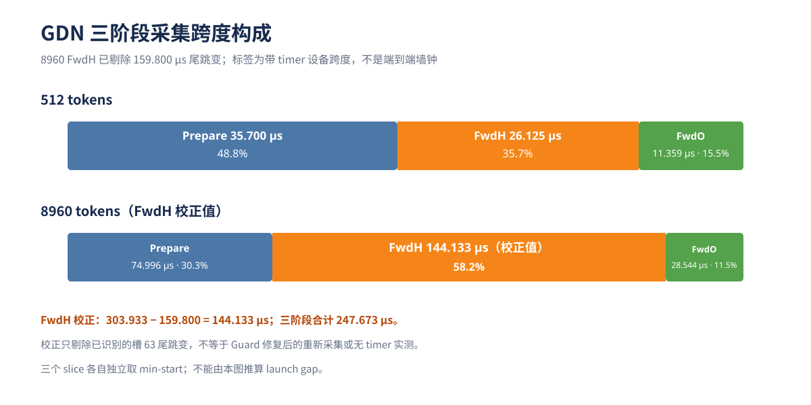
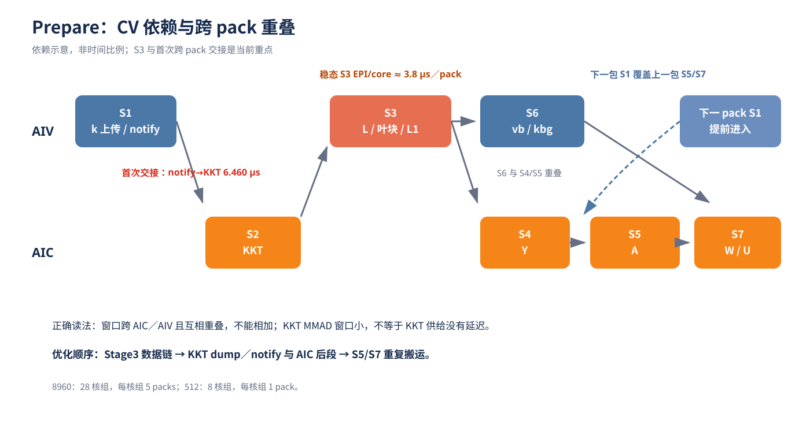
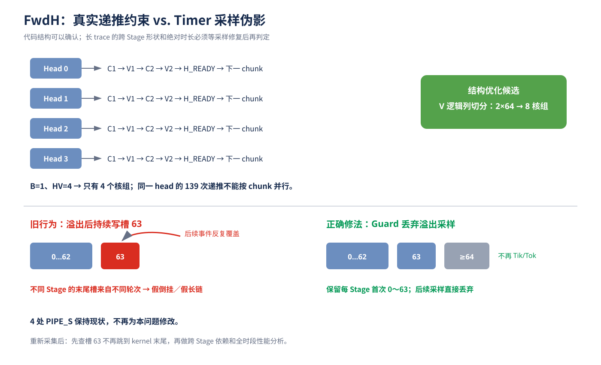

# GDN 三阶段 Profiling 汇报讲稿

> 建议时长：12～15 分钟，另留 5 分钟问答。
> 汇报主线：**整体结论 → 三阶段职责 → 逐图定位 bound → 优化方案与收益 → 下一步验收。**
> 适用材料：`gdn_overview.svg`、`gdn_prepare_pipeline.svg`、`gdn_fwdh_timer_guard.svg`，以及 MindStudio Insight 渲染的 Prepare／FwdH／FwdO 三份 JSON。

## 一、开场：先让领导知道这次解决了什么问题

**讲稿：**

“这次我主要回答三个问题：第一，GDN 在 NPU 上到底是怎么执行的；第二，时间到底花在计算、数据搬运，还是 CV 交接和并行度不足上；第三，下一步应该优化哪里，预期能拿到多少收益。

先说结论：小 shape 和大 shape 的瓶颈不一样。512 tokens 下，Prepare 是采集中的最大阶段；8960 tokens 下，剔除已经确认的打点尾跳变后，FwdH 仍占三阶段校正总和的 58.2%，是首要结构优化对象。Prepare 的重点不是简单提升 KKT 矩阵算力，而是 Stage3 数据链和跨 pack 交接；FwdO 有局部优化空间，但整体优先级靠后。”

**这一句作为全场主线：**

> “我们不是凭一个最长色块下结论，而是把代码依赖、逐核时间轴和各阶段占比放在一起，确定真正的关键路径。”

---

## 二、GDN 整体流程：为什么拆成 Prepare、FwdH、FwdO

### 2.1 三阶段分别做什么

**讲稿：**

“GDN 的输入主要是 Q、K、V、门控衰减 g 和 beta，最终要计算输出 O，并按需维护递推 state。当前 NPU 实现把它拆成三个 kernel。

第一步是 Prepare。它把原始输入加工成后两步需要的矩阵和中间量，包括 KKT、A、W、U，以及 vb、kbg 等。这里既有 Cube 矩阵计算，也有大量 AIV 向量计算、下三角处理和 UB／L1 数据重排。

第二步是 FwdH。它沿 chunk 递推隐藏状态，同时产生 H 和 V_new。H 给后续 FwdO 使用，V_new 同时参与当前输出和下一块 state 更新。这里的核心是**同一 head 的 chunk 必须顺序递推**。

第三步是 FwdO。它把 Q/K、H、V_new 和门控结果组合成最终输出 O，包括 QK、QH、Mask／衰减、A′@V_new 和输出融合。”

```text
输入 Q/K/V/g/beta
       ↓
Prepare：KKT、A、W、U 等中间矩阵
       ↓
FwdH：逐 chunk 更新 state，生成 H、V_new
       ↓
FwdO：计算并写出最终 O
```

### 2.2 看图前先统一口径

**讲稿：**

“流水图里 AIC 主要承担 Cube 矩阵计算，AIV 承担向量和数据重排，MTE 承担搬运。图中的命名窗口表示代码打点的起止，不一定等于硬件 pipe 的完整忙碌时间；不同核、不同 pipe 的窗口可以重叠，所以不能把所有色块宽度直接相加当总时间。

另外，三份 JSON 各自取时间原点，因此三阶段跨度之和只用于看构成，不能从三张图之间的位置推断 host launch gap。最终性能要用无 timer 的 Task Duration 验收。”

---

## 三、整体构成：先确定优先级，再进入单阶段细节

*展示 `gdn_overview.svg`。*



**讲稿：**

“先看两个 case 的整体构成。

512 tokens 下，Prepare、FwdH、FwdO 的采集跨度分别是 35.700、26.125 和 11.359 微秒，Prepare 占 48.8%，是当前最大阶段。

8960 tokens 下，Prepare 是 74.996 微秒，FwdO 是 28.544 微秒。FwdH 原始跨度是 303.933 微秒，但其中包含一个已经定位的 159.800 微秒动态槽尾跳变；剔除这个采样伪影后是 144.133 微秒。按校正值看，FwdH 占 58.2%，Prepare 占 30.3%，FwdO 占 11.5%。

所以优化顺序是：先处理 FwdH 的结构性并行问题，再处理 Prepare 的 Stage3 和交接，最后做 FwdO 局部优化。这里的 144.133 微秒仍是带 timer 数据的校正值，不把它冒充成无 timer 实测；但它已经比原始 303.933 微秒更接近可用于结构分析的形状。”

| tokens | Prepare | FwdH | FwdO | 首要观察对象 |
|---:|---:|---:|---:|---|
| 512 | 35.700 µs，48.8% | 26.125 µs，35.7% | 11.359 µs，15.5% | Prepare 首包与固定成本 |
| 8960（校正值） | 74.996 µs，30.3% | 144.133 µs，58.2% | 28.544 µs，11.5% | FwdH 并行度与递推链 |

---

## 四、Prepare：按 pack 讲清流程、重叠和真正的 bound

*切换到 MindStudio Insight 的 Prepare 图；必要时配合 `gdn_prepare_pipeline.svg`。*



### 4.1 先解释 pack，否则流水图很容易被误读

**讲稿：**

“看 Prepare 之前先解释 pack。pack 不是矩阵 packing，也不是一个 64-token chunk 的别名。最小工作项是一个 `(chunk, value head)` task；当前 G=2，一个完整 pack 包含同一 chunk 的 4 个 value-head tasks。

这 4 个 task 覆盖 2 个 HK，每个 HK 只计算一次 KKT，所以一个 pack 有 2 份 KKT，不是 4 份。两个 AIV 各处理两个 task。512 下只有 8 个 packs，所以只有 8／28 核组活跃；8960 下有 140 个 packs，28 个核组各执行 5 包。”

### 4.2 S1～S7 每一步在做什么

**讲稿：**

“沿着一条主链看：

S1 上传 k，并做 q、g、beta 的准备；k 准备好后 notify AIC。

S2 是 AIC 计算 KKT。之前我们关注过 notify 到 KKT 之间是否有异常空档，现在的图里首包 notify 后 KKT 能紧跟着启动，说明不能再把它解释成固定的调度错误。

S3 是 Prepare 的重点：AIV 把 KKT 和门控衰减结合，生成严格下三角所需的 L，并完成叶块打包和 UB／L1 数据路径。这一阶段不只是向量乘法，还有较多遍历、重排和产物交接。

S4 和 S5 回到 AIC，通过叶块矩阵计算最终生成 A。S6 在 AIV 上计算 vb 和 kbg，它不必等 S4／S5，因此可以与 Cube 后段重叠。

S7 用 A 分别计算 W 和 U。S7_DRAIN 不是新的数学计算，而是把上一 pack 暂存在 AIV UB 的 W／U 写回 GM。故意延迟 drain，是为了让上一包后段与下一包 S1 重叠。”

```text
S1 → S2 KKT → S3 L/叶块 → S4 → S5 A → S7 W/U
                  ↓
                  S6 vb/kbg，可与 S4/S5 重叠

下一 pack S1 只等上一 pack S4 释放关键 L1 槽，不等 S7 全部结束
```

### 4.3 Prepare 的 bound 在哪里

**讲稿：**

“Prepare 要分首包、首次交接和稳态来讲。

512 只有每核组一包，主要问题是初始化、S0、首包和单条 CV 数据链的固定成本，没有后续包摊薄。

8960 的首包 notify 到 KKT 中位只有约 0.883 微秒，但 pack 1 首次跨包交接扩大到 6.460 微秒，S3 等待也升到 10.267 微秒，说明第一次跨包供给存在明显空泡。到 pack 2～4，S3 等待回落到约 0.7～1.7 微秒，所以不能把首次交接误当成所有稳态包的共性。

稳态最大的命名工作项是 S3B_EPI，每核组五包合计约 22.5 微秒；纯 S2_KKT 只有约 1.6 微秒。虽然这些窗口不能直接当墙钟相加，但量级足以说明：**当前没有证据说 Prepare 是 KKT MMAD throughput bound，优先对象应是 Stage3 数据链和交接。**”

**指图时这样说：**

- 指 S3B_EPI：“这是稳态的主要工作项，包含计算和 UB／L1 数据路径。”
- 指 pack 1 的 KKT 前空档：“这是一次性跨包供给问题，要与稳态分开。”
- 指 S6 与 S4／S5 的重叠：“这里已经是有效重叠，不能再把 S6 全部算成串行尾长。”
- 指下一包 S1 与上一包 S7 的交叠：“这说明当前跨 pack 流水已经存在，优化是消除剩余空泡，不是从零开始做流水。”

---

## 五、FwdH：真正的约束是递推关键路径和活跃核组数

*切换到 MindStudio Insight 的 FwdH 图。*

### 5.1 先讲数据依赖，再看色块

**讲稿：**

“FwdH 不能简单按 140 个 chunks 并行，因为同一 head 的下一块必须等上一块 state 完成。

每个 chunk 先取入口状态 R，生成 BF16 的 H 快照；AIC 计算 P=W@H；AIV 计算 V_new=U-P，并生成带相对衰减的 right；AIC 再算 D=K^T@right；最后 AIV 更新 FP32 rolling state，生成下一块 H。这个 H_READY 是下一块继续执行的前提。”

```text
H_c → P=W@H → V_new/right → D=K^T@right → R_{c+1}/H_{c+1}
 ↑                                                    |
 └──────────── 同一 head 的下一块必须等待 ────────────┘
```

“当前实现已经做了几项重要优化：W/K 在 AIC L1 双 bank 预取，U/g 在 AIV UB 双 bank 预取；FP32 rolling state 常驻 AIV UB，不逐 chunk 从 GM 恢复；首个无初态 chunk 跳过 P=W@H；最后 chunk 在不请求 final state 时跳过没有消费者的 Stage2／Stage3。因此，‘再加普通预取’或‘把 state 改成常驻’不是新的优化方案。”

### 5.2 FwdH 的 bound 在哪里

**讲稿：**

“当前采集 case 是 B=1、HV=4，host 按 value head 分派，所以只有 4／28 核组活跃。8960 tokens 下，每 head 有 140 个 chunks、139 次完整 state 更新。token 增加只会把每条递推链拉长，不会增加活跃核组数。

因此 FwdH 是**并行度不足加逐 head 递推关键路径 bound 的强候选**。W/K/U/g 预取可以隐藏输入搬运，但不能消除 H、P、right、D 的生产消费关系。这里不能把某一段简单归结为 Cube 或 Vector 已打满，因为当前 timer 不提供完整 pipe busy time。”

### 5.3 主动解释原始长尾巴，避免领导被 303.933 µs 带偏

*展示 `gdn_fwdh_timer_guard.svg`。*



**讲稿：**

“FwdH 原始图里有一个异常长尾，我们已经定位不是某一轮真实计算突然慢了，而是动态打点槽只有 64 个。旧实现超过上限后反复覆盖 63 号槽，导致不同 Stage 的末尾事件不属于同一轮，拼出假的跨 Stage 长链。

正确修法是溢出后让现有 Guard 丢弃后续采样，保留每个 Stage 第一次记录的 0～63 槽，不再覆盖 63。本文整体占比已经剔除已识别的 159.800 微秒尾跳变；后续还要用修复后的 Guard 重采，并用无 timer Task Duration 做最终验收。”

---

## 六、FwdO：局部最大项是 Mask，但整体优先级靠后

*切换到 MindStudio Insight 的 FwdO 图。*

**讲稿：**

“FwdO 的流程是：先算 gate_o／gate_A，再做 QK 和 QH；AIV 对 QK 结果做 tril、门控衰减和 A′重排，同时缩放 QH；然后 AIC 计算 A′@V_new；最后 AIV 融合两部分结果并写回 O。

当前已经做了 Q/K 在同一 HK 的 value heads 间复用、V_new 领先一个 head 预取，以及下一组 Q/K/H 的传输前移。

从命名窗口看，V2 Mask 是最大的 AIV 阶段，每核组五组任务合计约 6.73 微秒，所以局部优化首先看 Mask 和 A′的 UB→L1 重排。但 8960 下 FwdO 只占三阶段校正总和的 11.5%，即使拿到不错的局部收益，对整体的贡献也有限，因此排在 FwdH 和 Prepare 后面。”

---

## 七、优化方案：讲清做法、预期收益和验证条件

**过渡讲稿：**

“下面的百分比是方案评审用的工程估算，表示耗时下降，不是已经实现的收益。整体估算是按当前 8960 的三阶段占比折算，各项之间不能简单相加，最终都以无 timer A/B 为准。”

| 优先级 | 做法 | 局部耗时下降预估 | 8960 三阶段合计降幅预估 | 主要风险 |
|---|---|---:|---:|---|
| P1 | FwdH V=128 切 2 个 64 列块，活跃核组 4→8 | 25%～40% | 14.6%～23.3% | W/K 复制读取、同步增加 |
| P1 | FwdH 切 4 个 32 列块，活跃核组 4→16 | 40%～60% | 23.3%～34.9% | 小 MMAD 效率、更多复制流量 |
| P1 后续 | 消除 right 的 GM 写读中转 | 5%～12% | 2.9%～7.0% | L1 容量、AIV→AIC 可见性和 WAR 协议 |
| P2 | Prepare Stage3 严格下三角与遍历／重排优化 | 单项 5%～15% | 单项 1.5%～4.5% | 短行向量效率、UB 容量；两项不能累加 |
| P2 | 修复首次跨 pack 交接、缩短 KKT→S3 产物路径 | 单项 2%～6% | 单项 0.6%～1.8% | 只移动空泡而没有缩短关键路径 |
| P3 | S5 direct L0C→L1、S7 复用 A 和跨 task 流水 | 单项 0%～6% | 单项 0%～1.8% | L0C／L0A 生命周期和现有重叠 |
| P4 | FwdO Mask、V_new 深预取、组边界和 Q 复用 | 单项 0%～12% | 单项 0%～1.4% | 整体占比低，小 shape 可能反噬 |

### 7.1 第一优先：FwdH 按 V 维切列

**讲稿：**

“第一优先不是把同一 head 的 chunks 强行并行，而是把 V=128 切成独立列块。对固定列块，P、V_new、D 和 R 的更新都不需要跨 V 归约，因此不同列块可以保持各自的 chunk 递推，在不同核组上独立执行。

切 2 列块可以把活跃核组从 4 提高到 8，切 4 列块可以提高到 16。代价是 W/K 可能重复读取，Cube N 变小，同步和 host／workspace 映射都会更复杂。所以先做 2 列块验证关键路径是否按预期缩短，再决定 4 列块，不直接承诺理想 2 倍或 4 倍加速。”

### 7.2 第二优先：Prepare Stage3 和交接

**讲稿：**

“Prepare 先从不改变数学语义的项目入手。Stage3 下游只消费严格下三角，因此可以裁剪无效上半区，并减少 LFull、LPacked、ResVcs 之间的重复遍历和重排。首次跨包交接则先细分 KKT dump、notify 和资源释放，确认 6.460 微秒空档到底由谁造成，再调整供给顺序。不是先删 wait，也不是先改 KKT 数学实现。”

### 7.3 后续项目

**讲稿：**

“Prepare 后段可以评估 S5 不再把 A 写到 GM 后又读回 L1，以及 S7 对同一份 A 的 L0A 复用。FwdH 的 right GM 往返也值得做专项评估，但它需要新的片上产物协议，不能只替换一条 DataCopy。FwdO 继续优化 Mask 和预取，但放在整体收益更高的项目之后。”

---

## 八、收尾：下一步怎么验收

**讲稿：**

“下一步分三层验收。

第一，测量可信：用修复后的 Guard 重采，确保不再出现末尾槽覆盖造成的假长尾。

第二，精度正确：V 切列覆盖 2／4 列块、尾 chunk、varlen、initial／final state 和不同 state layout；Prepare 重排覆盖 pack 边界和 tail。

第三，性能真实：所有优化都用相同输入做无 timer A/B，以 msprof op_summary 的 Task Duration 为准，分别记录 Prepare、FwdH、FwdO，不用 timer 图宽度代替最终性能。

另外，当前详细 profiling 是 HK=2、HV=4。目标模型是 HK=16、HV=32，我们已经补了目标 case 的采集方案。HV=32 会把 FwdH 活跃核组从 4 提到 16，但每 head 的递推链并没有缩短，所以目标 shape 仍需实测，不能直接套用当前收益区间。

总结一句：**我们已经把问题从‘图上哪里长’推进到‘哪条依赖链在限制性能、用什么结构改动去缩短、如何证明收益真实’。**”

---

## 九、领导可能追问的问题与回答口径

### Q1：为什么不直接把三个 kernel 融合？

“当前三份 trace 是独立时间原点，不能据此证明 host launch gap 是主要瓶颈。融合可能减少启动和中间 GM 往返，但也会增加寄存器／片上资源和调度复杂度。先优化已经确认的内部关键路径；是否融合要用统一绝对时间轴和端到端数据另证。”

### Q2：Prepare 为什么不直接提升 KKT Cube 算力？

“纯 KKT 命名窗口每核组五包合计约 1.6 微秒，而 Stage3 EPI 约 22.5 微秒。窗口不能简单相加，但当前证据更支持 Stage3 数据链和交接是主要问题，没有证据表明 KKT MMAD 已打满。”

### Q3：FwdH 为什么不能像 FwdO 一样按 chunk 并行？

“FwdO 各 chunk 的输入 H 已经准备好，输出计算相对独立；FwdH 的 chunk c+1 需要 chunk c 更新后的 state，存在真正的递推依赖。可并行的是不同 head 或同一 head 的不同 V 列块，不是同一 head 的不同 chunks。”

### Q4：HV=32 后是不是就没有 FwdH 瓶颈了？

“不是。HV=32 时 host 计算得到 headsPerCore=2、blockDim=16，即 16 个核组各处理 2 个 heads，不是 32 核或 28 核全部活跃。并行度会改善，但每 head 的 chunk 递推链长不变，总工作量也增加，需要目标 shape 的实测。”

### Q5：159.800 µs 是不是被你们‘减掉’来让数据好看？

“不是性能优化，也不是把真实计算删除。它是动态槽 63 被后续事件覆盖后形成的采样尾跳变。报告同时保留原始 303.933 µs 和校正口径，并明确要求 Guard 修复重采和无 timer Task Duration 验证，不用校正值冒充最终性能。”

### Q6：优化收益百分比是承诺吗？

“不是，是基于当前占比、理想并行上界和已有重叠情况给出的实验目标。P1 收益高但结构风险也最高；P2／P3 更适合小步 A/B。每完成一项就用实测替换预估值。”

### Q7：为什么不继续加 W/K 预取或把 state 常驻 UB？

“这些已经在当前 FP32 scalar-g 路径里实现了。W/K 和 U/g 都有双 bank，FP32 rolling state 已常驻 AIV UB。继续重复做不会形成新增收益，下一步应解决递推并行度和 right／H／V_new 的数据路径。”

### Q8：现在最需要什么支持？

“优先支持 FwdH V 切列的方案与资源评审，以及目标 HV=32 case 的完整采集。先用小步实验确认 2 列块是否有净收益，再决定是否投入 4 列块和更复杂的 right 片上路径。”

---

## 十、汇报时不要踩的口径风险

1. 不说“FwdH 真实耗时就是 144.133 µs”，应说“剔除已识别采样尾跳变后的校正跨度”。
2. 不说“三阶段相加就是端到端”，应说“用于观察采集构成，不含真实 launch gap”。
3. 不把命名窗口宽度当作 pipe busy time，也不把各窗口相加当利用率。
4. 不说“Prepare 已证明 DDR bound／KKT Cube bound”，当前证据不支持。
5. 不把 S6、S7 或 S7_DRAIN 全部当成串行尾长，它们已有跨 Stage／跨 pack 重叠。
6. 不把 HV=4 的占比和收益区间直接套到 HV=32。
7. 不把优化预估区间说成实测承诺，也不把相互重叠的优化项收益相加。
8. 不通过逐核 ANCHOR 对齐讨论真实跨核先后，也不用 `--sequential` 图推断 kernel launch 间隔。
