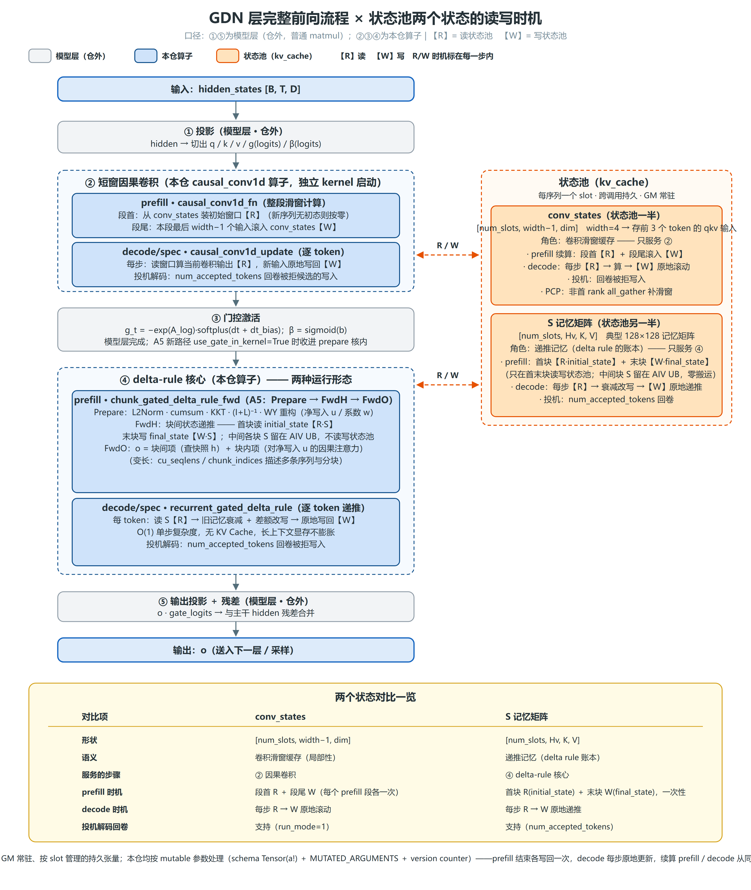

# GDN 原理梳理：算法逻辑流程与硬件流水

> 日期：2026-10-09
> 配图：本目录下三张图，本文按"层级 → 算子内步骤 → 硬件流水"三层展开，每层一张图
> 第 6 节是打点实测与瓶颈分析，可直接作为优化索引使用

***

## 1. 三层视角总览

| 层               | 看什么                                             | 对应配图                            |
| --------------- | ----------------------------------------------- | ------------------------------- |
| 逻辑层（模型层）        | GDN 层完整前向：投影 → 卷积 → 门控 → 核心 → 输出投影；状态池两个状态的读写时机 | 图 1 `gdn_layer_flow_states.png` |
| 算子层（kernel 内步骤） | 三个 kernel 各自的步骤序列，每步是 Cube 还是 Vector，步骤间串行/并行关系 | 图 2 `gdn_fla_npu_cv_flow.png`   |
| 硬件层（流水时间轴）      | AIC（Cube）/ AIV（Vector）两条流水随时间的排布、重叠与 flag 依赖    | 图 3 `gdn_fla_npu_pipeline.png`  |

一句话：**kernel 之间串行（Prepare → FwdH → FwdO，GM 传数据）；kernel 内 Cube/Vector 两条流水用 flag 握手交替，握手之外的每一刻用并行填满。**

***

## 2. 图 1：层级流程图——模型层全链 + 状态池



**主干五步**（颜色区分仓内/仓外）：

1. **投影**（模型层，仓外）：hidden 切出 q / k / v / g(logits) / β(logits)；
2. **短窗因果卷积**（本仓 `causal_conv1d` 算子，独立 kernel）：每个 token 和前 width−1 个位置加权混合，补上局部性；
3. **门控激活**：g\_t = −exp(A\_log)·softplus(dt+dt\_bias)，β = sigmoid(b)；A5 新路径 `use_gate_in_kernel=True` 时收进 prepare 核内；
4. **delta-rule 核心**（本仓算子）：prefill 走 chunked 流水线（Prepare → FwdH → FwdO），decode/spec 走逐 token 递推（`recurrent_gated_delta_rule`）；
5. **输出投影 + 残差**（模型层，仓外）。

**状态池两个状态（每序列一个 slot，GM 常驻，跨调用持久）**：

| <br />     | conv\_states            | S 记忆矩阵                                        |
| ---------- | ----------------------- | --------------------------------------------- |
| 形状         | `[slots, width−1, dim]` | `[slots, Hv, K, V]`                           |
| 语义         | 卷积滑窗缓存（局部性）             | 递推记忆（delta rule 账本）                           |
| 服务步骤       | ② 因果卷积                  | ④ delta-rule 核心                               |
| prefill 时机 | 段首 R + 段尾 W（每段各一次）      | 首块 R(initial\_state) + 末块 W(final\_state)，一次性 |
| decode 时机  | 每步 R → W 原地滚动           | 每步 R → W 原地递推                                 |
| 投机回卷       | 支持（run\_mode=1）         | 支持（num\_accepted\_tokens）                     |

两者均为 mutable 参数（schema `Tensor(a!)` + `MUTATED_ARGUMENTS` + version counter）。

***

## 3. 图 2：Cube/Vector 分工图——算子内步骤


**Kernel ① Prepare**（MIX AIC:AIV = 1:2；产 g\_cumsum / A / w / u）：

| 步骤    | 单元 | 计算                                                        |
| ----- | -- | --------------------------------------------------------- |
| S0+S1 | V  | 常驻辅助（I\_vcs/索引/清零）；k̂=L2Norm(k) 传 L1；g′/β 准备              |
| S2    | C  | KKT = k̂·k̂ᵀ（每 key head 一次，L0 双 bank 轮转）                  |
| S3    | V  | G = exp\*(g\_i−g\_j)；L = KKT⊙G 取严格下三角；切出对角两个 32×32 小块送 L1 |
| S4    | C  | Y = I + LeafLeft·(−L)（求逆第一步；I·I 预填充与 Vector 计算重叠）         |
| S5    | C  | A = LeafLeft + Y·LeafRight = (I+L)⁻¹（结算矩阵）                |
| S6    | V  | vb = v·β，kbg = k̂·β·exp\*(g′) —— **与 S4/S5 并行**（无数据依赖）    |
| S7    | C  | W = A·kbg，U = A·vb（WY 重构；L0C 经 Fixpipe 直写 AIV UB）         |

**Kernel ② FwdH**（每块四步 C1→V1→C2→V2；同一序列块间串行，是数学上的递推依赖）：

| 步骤 | 单元 | 计算                                                      |
| -- | -- | ------------------------------------------------------- |
| C1 | C  | P = w·S\_c（算历史重复信息：上一段记忆对当前块的影响）                        |
| V1 | V  | v\_update = (u − P)⊙衰减（扣掉历史重复信息，按各行写入时刻衰减）              |
| C2 | C  | h\_work = kᵀ·v\_update（把 64 个 token 真正写进记忆的部分，一次矩阵乘全加上） |
| V2 | V  | S\_c+1 = 按行衰减⊙S\_c + h\_work（存快照 h、v\_new；置 H 就绪 flag）  |

**Kernel ③ FwdO**（每块五步）：

| 步骤 | 单元 | 计算                                             |
| -- | -- | ---------------------------------------------- |
| V1 | V  | 衰减因子 exp\*(g) 准备                               |
| C1 | C  | 双矩阵乘：attn = q·kᵀ（块内，含对角线）＋ O\_s = q·h\_快照（块间项） |
| V2 | V  | 因果掩码 tril + 衰减加权 → A′；O\_s′ = exp(g)·O\_s      |
| C3 | C  | O\_l = A′·v\_new（块内项）                          |
| V3 | V  | o = scale·(O\_s′ + O\_l)，FP32 融合后转 BF16 写回     |

**串行/并行规则**（详见第 4 节流水解释）：

- 串行：kernel 间；同序列块间（H 就绪 flag，逐 head）；同一条数据链上的 C→V→C→V（flag 握手）；FwdO 组边界（C1′ 等上组 V3 收尾）；
- 并行：不同序列/头跨核组；kernel 内 Cube/Vector 两条流水；预取与计算重叠；AIV0/AIV1 双 head 双缓冲。

***

## 4. 图 3：硬件流水图——AIC/AIV 双流水时间轴


**物理基础**：一组编队 = 1 AIC + 2 AIV。AIC 挂 L1（\~512KB）→ L0A/B/C（矩阵乘缓冲），管道 MTE1（L1→L0）/ Fixpipe（L0C 出结果）；AIV 挂 UB（\~256KB），管道 MTE2（GM→UB）/ MTE3（UB→GM）。**两类核的片上存储互相看不见**，每次 C↔V 接力理论上要过一圈 GM workspace——流水设计的目标就是让这笔"接力税"不出现在关键路径上。A5 缓解：AIC 的 L0C 结果可经 Fixpipe 直写配对 AIV 的 UB。同步靠 flag（SetFlag/WaitFlag），每个缓冲配 `XXX_READY / XXX_FREE` 一对，构成 ping-pong 双缓冲。

**三段流水的要点**：

1. **Prepare**：S6（V）与 S4/S5（C）两条流水同时开算；**包间无全局屏障**——AIC 的 S2′ 紧接 S7 开跑，包 N+1 的 S1′ 在 AIV 上与包 N 的 S5 尾段/S7 重叠（k̂ 与 −L 复用 L1 地址，需等包 N 的 S4 用完）。S7 的 W/U 经 Fixpipe 落 AIV UB 后**不立即回写**，推迟到下一包 S3′ 完成后的窗口才排空到 GM；AIV 在包边界等下一包 KKT′ 是主要的局部等待。
2. **FwdH**：块间串行是唯一硬约束（V2(c) 置 H 就绪 flag 后 C1(c+1) 才能开算；flag 逐 head 置位——C1(c+1,h0) 只等 V2(c,h0)，跨块仍有 head 级重叠）。三个填空手段——**head 双缓冲**（AIV0 管 head 0/2、AIV1 管 1/3，L0 双 bank 轮转）；**lookahead 预取**（AIC 算当前块 C2 时 MTE2 已在搬下一块 W/K，flag 一到零延迟开算）；**状态驻留**（S 全程住 AIV UB，仅首块读 initial\_state、末块写 final\_state，中间零 GM）。
3. **FwdO**：每 chunk 相位式推进——AIV 先算完本组全部 head 的 V1（gate 因子），与 AIC 的 C1（双矩阵乘）**并行**（C1 只等预取事件，不等 V1）；随后 V2↔C3 逐 head 接力（attn→A′→v\_part），V3 融合收尾；C3 的 v\_new 预取**领先一个 V head**，操作数（A′/v\_new 都是 AIV 刚产出的热数据）提前进 L1。组边界是串行点：下一组的 C1′ 要等本组 V3 全部收尾（缓冲复用回压）。

**图外的两层并行**：① 核组间——host 把 (序列， value head) 展平成 head task 均分给 28 组核，不同序列/头全并行；② **H/O 块级流水**（perf 分支）——16 组生产者跑 FwdH + 12 组消费者跑 FwdO 同时开工，FwdH 每完成一个 (块， 头) 用 IBSet 原子置位，FwdO 的消费任务 IBWait 自旋等对应槽位，前面的块还在 FwdH 手里时后面的块已在 FwdO 被消化，消掉了全局屏障的空泡。

***

## 5. 结论

**流水的本质**：串行是数据依赖逼的（kernel 链、块间递推、步骤间接力），并行是把每个等待窗口用另一条流水、另一个 head、下一块的预取或另一个核组填满。当前已有四层并行：C/V 两条流水、ping-pong 双缓冲、lookahead 预取、核组分片 + H/O 块级流水。

***

## 6. 打点实测：三阶段逐步对应与瓶颈

> 数据：`B=1, T=11274, Hk=16, Hv=32, chunk=64`（177 chunk、5664 work item、1416 pack），
> 频率按 1800 cycles/us 折算。下面的 us 只用于横向比较，频率标定后需整体缩放。
>
> 口径：动态项都是 **issue 窗口**（标量/pipe 下发时刻），不是完成时刻；`PREP_WAIT_*` 测的是
> 标量越过 wait 指令的时间，**不能当等待时长**（`CrossCoreWaitFlag<…, PIPE_MTE1>` 只挡 pipe，
> 标量继续跑，所以 AIC 的 bar 会画在依赖满足之前）。每核每阶段只保留前 64 次调用。

### 6.1 阶段总账

| kernel  | 每核墙钟中位  | 每核最大    | 每核 stage 调用数            | 单次墙钟              |
| ------- | ------- | ------- | ----------------------- | ----------------- |
| Prepare | 447.2us | 459.8us | 50.6 pack（AIV 101 次/项）  | 8.84us/pack       |
| FwdH    | 328.7us | 333.1us | 354（2 head × 177 chunk） | 0.93us/head-chunk |
| FwdO    | 205.9us | 208.8us | 202 chunk               | 1.16us/chunk      |

核间很均衡（max/med ≤ 3%），瓶颈不是分核不均。

***

### 6.2 Prepare：预处理、求下三角、求逆

**一次性开销（每核一次，不按 pack 摊）**

| 步骤                      | 打点                     | med         | max         | 说明            |
| ----------------------- | ---------------------- | ----------- | ----------- | ------------- |
| 初始化：建地址视图               | `PREP_INIT_MAP`        | 0.76        | 1.31        | 84 核各一次       |
| 初始化：绑 workspace / GM 指针 | `PREP_INIT_GM` / `_WS` | 0.29 / 0.15 | 0.52 / 0.41 | 同上            |
| 常驻辅助表（I\_vcs、索引）        | `PREP_RESIDENT_AUX`    | 0.68        | 1.09        | 56 个 AIV 各一次  |
| 尾块补齐                    | `PREP_PAD_TAIL`        | 0.21        | 0.70        | 仅尾块 32 个 task |

**AIV lane（每 pack 墙钟 8.84us，打点覆盖 6.75us = 76.2%）**

| 步骤                       | 打点                    | us/pack  | 单kernel占比 | 计算占比      |
| ------------------------ | --------------------- | -------- | --------- | --------- |
| **取严格下三角 + 切对角块 + 送 L1** | `PREP_KKT_EPI`        | **2.32** | **26.2%** | **34.4%** |
| 算 kbg = k'·β·e^g         | `PREP_WU_K`           | 1.10     | 12.4%     | 16.3%     |
| k' 归一化并上传 L1             | `PREP_K_UPLOAD`       | 1.06     | 12.0%     | 15.7%     |
| 算 vb = v·β               | `PREP_WU_V`           | 0.96     | 10.9%     | 14.2%     |
| g' 累加与 β 预处理             | `PREP_GATE_BETA`      | 0.44     | 5.0%      | 6.5%      |
| W/U 回写 GM                | `PREP_WU_DRAIN`       | 0.33     | 3.7%      | 4.9%      |
| 算衰减权重 G，与 KKT 逐元素乘       | `PREP_KKT_GATE`       | 0.28     | 3.2%      | 4.1%      |
| 等待窗口（标量口径）               | `WAIT_S4 / WAIT_CUBE` | 0.26     | 2.9%      | 3.9%      |
| **未覆盖（等待/搬运）**           | —                     | 2.10     | **23.8%** | —         |

**AIC lane（同一 pack 墙钟 8.84us，打点覆盖 3.44us = 38.9%）**

| 步骤                          | 打点                   | us/pack | 单kernel占比 | 计算占比  |
| --------------------------- | -------------------- | ------- | --------- | ----- |
| 求逆第二步 A = (I+L)^-1          | `PREP_SOLVE`         | 0.84    | 9.5%      | 24.4% |
| 算 W = A·kbg                 | `PREP_W_ISSUE`       | 0.84    | 9.5%      | 24.4% |
| 求逆中间结果写回 L1/UB              | `PREP_SOLVE_DUMP`    | 0.44    | 5.0%      | 12.8% |
| 求逆第一步 Y = I + LeafLeft·(−L) | `PREP_SOLVE_ISSUE`   | 0.36    | 4.1%      | 10.5% |
| 算 KKT（k'·k'^T）              | `PREP_KKT_MM`        | 0.24    | 2.7%      | 7.0%  |
| 单位阵预填充（I·I）                 | `PREP_SOLVE_PREFILL` | 0.16    | 1.8%      | 4.7%  |
| 算 U = A·vb                  | `PREP_U_ISSUE`       | 0.16    | 1.8%      | 4.7%  |
| 等待窗口（标量口径）                  | `WAIT_S1 / S3 / S6`  | 0.40    | 4.5%      | 11.6% |
| **空闲（等 AIV / 等自己的内存）**      | —                    | 5.40    | **61.1%** | —     |

合计：AIV 覆盖 **76.2%**、AIC 覆盖 **38.9%**。AIV 的 \~2.1us/pack 缺口主要在
**准备 k' 的** **`DataCopy(ubK)`** **+** **`L2NormK128VF`**（在 `PREP_K_UPLOAD` 窗口之前，未打点）。
**AIV 是唯一关键路径，AIC 有 61% 在空转。**

> 注：`PREP_RESIDENT_AUX` 与 `PREP_PAD_TAIL` 不在图 2 的"每块步骤"里。
> 前者是每个 AIV 核**开跑前一次**的常驻准备（清零 4 个 L1 leaf 槽，AIV0 额外画 64×64 单位阵），
> 对应图 2 的"S0 常驻辅助"；后者只在**序列最后一个 chunk**（M<64）时把 UB 尾行补零，
> 满块直接 return，所以主流程图没有单独一步。

**瓶颈判断**

1. **取严格下三角**（`PREP_KKT_EPI`）1.16us/次：占 **AIV 计算时间的 34.4%、单 kernel 的 26.2%**。
   `MulKktGateVF` 做的是 **64×64 全量逐元素乘**，但下游只取**严格下三角**；
   随后**切出对角两块**（`PackDiagLeaves`）、**写 16KB 到 L1**（`UbNd64ToL1Nz8`）、
   **两块相乘**（`MulReduceScatterVF32`）也都在这一步。
2. **算 vb 与 kbg** 2.06us/pack（单 kernel **23.3%**）：两次独立的 GM→UB→L1，各一次全量搬入搬出。
3. **k' 归一化** 的 DataCopy 与 L2Norm 在窗口外，量级未测，但按 76.2% 覆盖率推算占 \~2us/pack（**\~23.8%**）。
4. AIC 侧的**求逆第二、W/U 下发**都不大，**Cube 不是瓶颈**；AIC 本身有 **61.1%** 在空转。

**可优化点**

| 动作                                             | 依据                   | 预期                      |
| ---------------------------------------------- | -------------------- | ----------------------- |
| `MulKktGateVF` 只算下三角（行内宽随 i 递减，或先 mask 掉上三角再乘） | 下游只用下三角，当前做全量        | 0.4–0.5us/pack（\~20us）  |
| `WU_V` + `WU_K` 合并成一次 UB 处理 + 一次 L1 写          | 两次独立 GM→UB→L1        | 0.3–0.4us/pack（\~20us）  |
| 给 S1 的 `DataCopy + L2Norm` 加一个窗口（计算项，不是 wait）  | 2.1us/pack 的缺口主要在这   | 先量化，再决定是否融合进 `K_UPLOAD` |
| 把 `WU_DRAIN` 提前到 `W_ISSUE/U_ISSUE` 之后立即做       | 当前推迟一包，占 0.33us/pack | 视依赖，收益小                 |

**补充：S3 尾段“切出对角两个 32×32 小块”到底在做什么**

`I+L` 是 64×64 的下三角矩阵，按 32 分块写成

```
[ I+A   0  ]        A、D 是两个 32×32 的下三角块，C 是左下角的耦合块
[  C   I+D ]
```

它的逆可以用块公式写出来，只需要**先求两个对角块的逆**：

```
[ (I+A)^-1                0        ]
[ -(I+D)^-1 · C · (I+A)^-1   (I+D)^-1 ]
```

所以 kernel 不对 64×64 直接求逆，而是：

1. **切块**（`PackDiagLeavesFromUb`）：从 64×64 的 L 里取左上 32×32（A）和右下 32×32（D），
   按 `[A | D]` 拼成一块 32×64。两次 `DataCopy`，`burst=4、gap=4`（每次搬 128B、跳过 128B），
   正好跳过右半边和上半边；
2. **对角块求逆**（`MulReduceScatterVF32`）：在 Vector 上同时算 `(I+A)^-1` 和 `(I+D)^-1`，
   再用 scatter 索引 `{0, 32}` 写回 `[左 | 右]` 布局；
3. **送 L1**（`UploadDiagLeavesToL1`）：把两块逆放回 **64×64 叶子矩阵**的对角象限
   ——`LeafRight` 左上 = `(I+A)^-1`，`LeafLeft` 右下 = `(I+D)^-1`，其余象限保持 Stage0 的清零；
   同时 `UbNd64ToL1Nz8` 把完整的 `−L` 也送进 L1；
4. **拼回 64×64**（Cube）：`Y = I + LeafLeft·(−L)`，`A = LeafLeft + Y·LeafRight`，
   两次矩阵乘就把整个 64×64 的逆拼出来了。

这一步的开销集中在前三步（64×64 逐元素乘、两次 DataCopy、16KB L1 写、对角块求逆），
所以它占了每 pack 的 26%。

***

### 6.3 FwdH：逐块状态递推

| 步骤（中文）                        | 打点             | med  | max  | 每 head-chunk | 单kernel占比 | 计算占比  |
| ----------------------------- | -------------- | ---- | ---- | ------------ | --------- | ----- |
| 预取下一块的 W/K（lookahead）         | `FWH_PREFETCH` | 0.09 | 0.49 | 0.09（AIC）    | 9.7%      | 32.1% |
| 算历史重复信息 P = w·S               | `FWH_WH_MM`    | 0.07 | 0.55 | 0.07（AIC）    | 7.5%      | 25.0% |
| 扣掉历史重复信息并按行衰减得 v\_update      | `FWH_VNEW`     | 0.04 | 0.83 | 0.04（AIV）    | 4.3%      | 14.3% |
| 算本块真正写入记忆的量 h = k^T·v\_update | `FWH_KV_MM`    | 0.06 | 0.43 | 0.06（AIC）    | 6.5%      | 21.4% |
| 状态递推 S ← decay⊙S + h          | `FWH_STATE`    | 0.02 | 0.58 | 0.02（AIV）    | 2.2%      | 7.1%  |
| **未覆盖（flag 接力 + 搬运）**         | —              | —    | —    | 0.65         | **69.9%** | —     |

合计打点 **0.28us（30.1%）**，而每 head-chunk 墙钟 **0.93us** → **69.9% 不在窗口内**。
两个 MMAD 只有 0.06–0.07us，**Cube 算力完全不是瓶颈**。

**瓶颈判断**

1. 硬约束是块间递推：状态递推(c) 置 H 就绪后，下一块重新计算历史重复信息(c+1) 才能开算，共 177 次；
2. 每 chunk 有 **4 次 Cube-Vector 接力**（历史重复信息→v\_update、v\_update→本块写入量、本块写入量→状态、状态→下一块历史重复信息），
   每次都有 flag 延迟 + L1/UB 搬运——这就是 **69.9% 未覆盖**的来源；
3. 同一核上 2 个 head 是**顺序**跑完一个再跑下一个（work unit 串行），没有互相填等待；
4. 预取只有 0.09us（单 kernel 9.7%），lookahead 深度可能不足以盖住历史重复信息那一步的 W/K 装载。

**可优化点**

| 动作                                                    | 依据                               | 预期               |
| ----------------------------------------------------- | -------------------------------- | ---------------- |
| **两个 head 交错**（chunk 级轮转），用一个 head 的计算填另一个 head 的交接等待 | AIV 94% / AIC 76% 在等；两 head 相互独立 | 20–35%（65–110us） |
| 减少每 chunk 的握手次数（例如 C2 与 V2 之间用一次 L0C→UB 直写替代 GM 往返）   | 4 次接力是主要延迟源                      | 视实现，5–10%        |
| 加深 lookahead（预取 c+2 的 W/K）                            | PREFETCH 0.09us 偏小               | 5%               |

***

### 6.4 FwdO：注意力与输出

`FWO_GATE` 是**按 head** 打点的：`taskGroupSize = 4`，AIV0 负责 head 0/2、AIV1 负责 1/3，
所以每个 chunk 每个 AIV 会调用 **2 次**——这就是图上“一次两段”的来源（两段是两个不同的 head，
不是同一个 gate 被拆成两半）。

**AIC lane（每核 202 次调用，墙钟 205.9us）**

| 步骤 | 打点 | med | 次/核 | 单kernel占比 | 计算占比 |
| --- | --- | --- | --- | --- | --- |
| 算块内注意力 attn = q·k^T | `FWO_QK` | 0.04 | 202 | 3.9% | 33.3% |
| 算块间项 O_s = q·h | `FWO_QH` | 0.04 | 202 | 3.9% | 33.3% |
| 算块内项 O_l = A′·v_new | `FWO_ATTN_V` | 0.04 | 202 | 3.9% | 33.3% |
| **未覆盖（接力 + 组边界）** | — | — | — | **88.3%** | — |

**AIV lane（每核 101 次调用，墙钟 205.9us）**

| 步骤 | 打点 | med | 次/核 | 单kernel占比 | 计算占比 |
| --- | --- | --- | --- | --- | --- |
| 准备衰减因子 exp*(g) | `FWO_GATE` | 0.05 | 101 | 2.5% | 27.8% |
| 因果掩码 + 衰减得 A′ | `FWO_MASK` | 0.08 | 101 | 3.9% | 44.4% |
| 融合输出 o = scale·(O_s′+O_l) | `FWO_OUTPUT` | 0.05 | 101 | 2.5% | 27.8% |
| **未覆盖（接力 + 组边界）** | — | — | — | **91.1%** | — |

合计打点：AIC 11.8% + AIV 8.8% = **20.6%**，**79.4% 在窗口外**。

**瓶颈判断**

1. 三个 MMAD（块内注意力 / 块间项 / 块内项）各 0.04us，**每核 202 次，合计 24.2us（11.8%）**，Cube 不是瓶颈；
2. 时间在 **块内注意力→因果掩码→块内项→融合输出** 的接力与**组边界**：
   下一组的块内注意力要等本组所有 head 的输出收尾（这就是 79.4% 未覆盖的来源）；
3. AIV 侧的**因果掩码** 0.08 是最大单项（单 kernel 3.9%，计算占比 44.4%），包含取三角 + 衰减加权 + 写 A′；
4. **衰减因子**（0.05）与**因果掩码**是两次对同量级数据的处理，可以融合。

**可优化点**

| 动作                                     | 依据               | 预期                       |
| -------------------------------------- | ---------------- | ------------------------ |
| v\_new 预取再提前一个 head，组边界只保留缓冲复用必要的那一次等待 | 79% 在窗口外，组边界是串行点 | 10–20%（20–40us）          |
| `GATE` 融进 `MASK`（一次 VF 完成衰减+掩码）        | 两次遍历同一块 A        | 0.03–0.05us/次（3–5us） |
| 保持 AIC 的三个 MMAD 流水，不单独优化               | 合计 0.12us/chunk  | —                        |

***

### 6.5 跨阶段汇总与优先级

| 阶段      | 墙钟      | 占比  | 打点覆盖       | 性质             | 第一优化项                 |
| ------- | ------- | --- | ---------- | -------------- | --------------------- |
| Prepare | 447.2us | 45% | **76%**    | 吞吐/搬运受限        | 取严格下三角 + 合并 vb/kbg 搬运 |
| FwdH    | 328.7us | 33% | **6–24%**  | 延迟受限（块间递推）     | **两 head 交错**         |
| FwdO    | 205.9us | 21% | **9–12%** | 延迟受限（接力 + 组边界） | v\_new 预取提前 / 组边界解耦   |

按绝对收益排序（估算）：

1. FwdH 两 head 交错：**65–110us**（最值得先做，改调度不改数学）；
2. Prepare 取严格下三角：**\~20us**；
3. Prepare 合并 vb/kbg 两次搬运：**\~20us**；
4. FwdO 预取/组边界：**20–40us**；
5. Prepare 准备 k' 的 load+norm：先补窗口量化，再决定。

合计约 **130–190us**，占全程 982us 的 **13–19%**。

***

### 6.6 整个 GDN 算子的瓶颈与优化

**总账**：一次 fwd 调用 ≈ **982us** = Prepare 447.2（45%）+ FwdH 328.7（33%）+ FwdO 205.9（21%），
三个 kernel **串行**，段间各约 2us 下发间隔（合计约 4us）。

**三个层次的瓶颈**

| 层次  | 现象            | 证据                                                                     | 结论                                      |
| --- | ------------- | ---------------------------------------------------------------------- | --------------------------------------- |
| 算子间 | 三段串行、无重叠      | 三段墙钟相加 = 全程；段间 2us                                                     | 融合 launch（PHASE6 / H-O 流水）是唯一能省掉段间空泡的手段 |
| 算子内 | 除 Prepare AIV（76%）外，其余 lane 的计算窗口只有 6–39%  | Prepare AIV 76% / AIC 39%；FwdH AIC 24% / AIV 6%；FwdO AIC 12% / AIV 9% | 成本主要是 **C/V 接力和 GM 搬运**，不是算力            |
| 单步  | 最大单项在 Prepare | 取严格下三角 26.2%；kbg+vb 23.3%；另有 23.8% 在窗口外（主要是 k' 的 load+norm）            | 先改 Prepare 的向量段，再改 FwdH/FwdO 的调度        |

**优化清单（按绝对收益，均已标注作用域与风险）**

| 优先级 | 动作                       | 作用域     | 预期                   | 风险 / 前提                             |
| --- | ------------------------ | ------- | -------------------- | ----------------------------------- |
| 1   | **两 head 交错**（chunk 级轮转） | FwdH    | **65–110us**         | 只改调度不改数学；要保证 S 状态 UB 驻留、L0 bank 不冲突 |
| 2   | **只算严格下三角**              | Prepare | **\~20us**           | 行内宽度变化，注意向量对齐；mask 上三角再乘也可          |
| 3   | **合并 vb/kbg 两次搬运**       | Prepare | **\~20us**           | 两次 GM→UB→L1 合成一次；注意 L1 槽位与事件依赖      |
| 4   | **v\_new 预取提前 / 组边界解耦**  | FwdO    | **20–40us**          | 缓冲复用回压，先确认正确性                       |
| 5   | **给 k' 的 load+norm 加窗口** | Prepare | 待量化                  | 先量化 \~2us/pack，再决定是否融进 `K_UPLOAD`   |
| 6   | 三段融合成 PHASE6             | 全局      | 省 \~4us 间隔 + 一次 init | 已有路径，需先过数值验收                        |

合计约 **130–190us**（13–19%），其中第 1 项单独就占一半以上。

**明确不该做的**

- **不要优化 MMAD**：FwdH/FwdO 的矩阵乘合计 < 0.2us/call，Prepare 的 Cube 段也只占 3–9%，Cube 从来不是瓶颈；
- **不要加全核 SyncAll**：会破坏 C/V 重叠，而且 prepare 的 tiling 没开 batch mode，会挂；
- **不要按** **`max`** **定目标**：首块/尾块是冷启动（`SOLVE` 首包 7.1us vs 稳态 0.21us）；
- **不要只看** **`KERNEL_TIMING`**：它含 init 和末尾 drain，正式性能口径仍以 msprof Task Duration 为准。

**如果只能改一处**：改 FwdH 的 head 调度。它在 329us 里只兑现了 30% 的计算窗口，
而且不需要动任何数学，是当前性价比最高的切入点。

***

### 6.7 读这份数据的三个注意

1. **issue ≠ 执行**：AIC 的 bar 会比 AIV 早 3–4us（标量跑在 `PIPE_MTE1` 前面），
   图上"KKT 在 K\_UPLOAD 前"是正常现象，执行顺序由 pipe 保证；
2. **每核每项只存 64 次**（`MAX_DYNAMIC_ITER = 64`）：一颗 AIC 带两颗 AIV，所以 AIC 每核的迭代次数是 AIV 的 **2 倍**
   （Prepare：AIC 202 次/核、AIV 101 次/核）。64 个槽位只够盖住 **AIC 的前 ~32%、AIV 的前 ~63%**——
   图上“后半段只剩 AIV”是**采样截止，不是 AIC 停工**：`MAIN_BODY` 一直跑到最后，
   而且个别核的第 64 个样本晚到 97% 才落盘。稀有打点不受影响（`PREP_PAD_TAIL` 每核只有 2 次，
   所以在 95% 处还能看到它）。也正因为如此，前面所有中位数都只代表**前 1/3 的 chunk**，
   并且混进了 `iter0` 的冷启动；
3. **频率未标定**：1800 是估计值，需用 msprof 的 Task Duration 对齐 `KERNEL_TIMING` 后再定性能目标。

---

## 7. 全算子总结

### 7.1 所有步骤的占比（一次 fwd 调用 ≈ 982us）

> Prepare 的两条 lane 都以“每 pack 墙钟 8.84us”为分母；FwdH 以“每 head-chunk 0.93us”为分母；
> FwdO 以“每核墙钟 205.9us”为分母。★ = 建议优化，✗ = 明确不优化。

| 阶段 | lane | 步骤 | 单kernel占比 | 判定 |
| --- | --- | --- | --- | --- |
| Prepare | AIV | 取严格下三角 + 切对角块 + 送 L1 | **26.2%** | ★ 只算下三角 |
| Prepare | AIV | 算 kbg = k'·β·e^g | 12.4% | ★ 与 vb 合并搬运 |
| Prepare | AIV | k' 归一化并上传 L1 | 12.0% | |
| Prepare | AIV | 算 vb = v·β | 10.9% | ★ 与 kbg 合并搬运 |
| Prepare | AIV | g' 累加与 β 预处理 | 5.0% | |
| Prepare | AIV | W/U 回写 GM | 3.7% | |
| Prepare | AIV | 算衰减权重 G，与 KKT 逐元素乘 | 3.2% | |
| Prepare | AIV | 等待窗口 | 2.9% | |
| Prepare | AIV | **未覆盖（k' 的 load+norm 等）** | **23.8%** | ★ 先补窗口量化 |
| Prepare | AIC | 求逆第二步 A = (I+L)^-1 | 9.5% | |
| Prepare | AIC | 算 W = A·kbg | 9.5% | |
| Prepare | AIC | 求逆中间结果写回 | 5.0% | |
| Prepare | AIC | 求逆第一步 Y = I + LeafLeft·(−L) | 4.1% | |
| Prepare | AIC | 算 KKT | 2.7% | ✗ 算力不是瓶颈 |
| Prepare | AIC | 单位阵预填充 | 1.8% | |
| Prepare | AIC | 算 U = A·vb | 1.8% | |
| Prepare | AIC | 等待窗口 | 4.5% | |
| Prepare | AIC | **空闲（等 AIV / 等自己的内存）** | **61.1%** | ✗ AIV 才是关键路径 |
| FwdH | AIC | 预取下一块的 W/K | 9.7% | ★ 加深 lookahead |
| FwdH | AIC | 算历史重复信息 P = w·S | 7.5% | |
| FwdH | AIC | 算本块真正写入记忆的量 h | 6.5% | ✗ MMAD 太快 |
| FwdH | AIV | 扣掉历史重复信息并衰减得 v_update | 4.3% | |
| FwdH | AIV | 状态递推 S ← decay⊙S + h | 2.2% | |
| FwdH | 两条 | **未覆盖（flag 接力 + 搬运）** | **69.9%** | ★★ 两 head 交错 |
| FwdO | AIC | 算块内注意力 attn = q·k^T | 3.9% | ✗ |
| FwdO | AIC | 算块间项 O_s = q·h | 3.9% | ✗ |
| FwdO | AIC | 算块内项 O_l = A′·v_new | 3.9% | ✗ |
| FwdO | AIC | **未覆盖（接力 + 组边界）** | **88.3%** | ★ |
| FwdO | AIV | 准备衰减因子 exp*(g) | 2.5% | ★ 与掩码融合 |
| FwdO | AIV | 因果掩码 + 衰减得 A′ | 3.9% | ★ 与衰减因子融合 |
| FwdO | AIV | 融合输出 o = scale·(O_s′+O_l) | 2.5% | |
| FwdO | AIV | **未覆盖（接力 + 组边界）** | **91.1%** | ★★ 预取提前 / 组边界解耦 |

### 7.2 为什么现在慢

**并行机制都在，但只兑现了一部分。** Prepare 的 AIV 有 76% 的时间落在计算窗口里，
而 AIC 只有 39%（61% 在空转）；FwdH 两条 lane 只有 30%；FwdO 的 AIC/AIV 分别只有 12% 和 9%。
也就是说，除了 Prepare 的 AIV，其余 lane 的绝大部分时间都不在“算”上，而在
**Cube↔Vector 的 flag 接力、GM↔UB↔L1 的搬运、以及组/块边界等待**上——
三个 kernel 的矩阵乘其实只有 0.04–0.21us/次，Cube 从来不是瓶颈。

**资源也没配平。** Prepare 的 AIC 空转 61%，说明这条 lane 的算力被浪费；
真正的关键路径是 AIV 的向量段（取严格下三角、kbg/vb 搬运、k' 归一化）。

**三段还是串行的。** Prepare → FwdH → FwdO 之间没有重叠，端到端就是三段相加，
外加约 4us 的下发间隔。

**首调用会放大 `max`。** `iter0` 要付指令取指和首次 GM 读的冷启动（`FWO_GATE_0` 0.53us
vs `_1` 0.097us），所以不要拿 `max` 当稳态。

### 7.3 优化方向

1. **FwdH 的两个 head 是顺序跑的**（329us 里只有 30% 在算，70% 在等），
   把两个 head 按 chunk 级交错，用一个 head 的计算填另一个的等待，预计省 **65–110us**。
2. **Prepare 的“取严格下三角”做了 64×64 全量逐元素乘**（占 AIV 26%），
   但下游只用严格下三角，只算下三角（或先 mask 再乘），预计省 **~20us**。
3. **vb 和 kbg 是两次独立的 GM→UB→L1**（合计占 AIV 23%），
   合并成一次 UB 处理 + 一次 L1 写，预计省 **~20us**。
4. **FwdO 的组边界和接力占 79%**（AIV 未覆盖 91%、AIC 88%），
   把 v_new 预取再提前一个 head、组边界只保留缓冲复用必需的那一次等待，预计省 **20–40us**。
5. **k' 的 load+norm 在窗口外**（~2.1us/pack 未解释），
   先补一个计算窗口把它量化，再决定是否融进 `K_UPLOAD`。
6. **三段串行 + 段间 2us**，用 PHASE6 / H-O 块级流水融合 launch，
   省掉段间空泡和一次 init，预计 **~4us**（需先过数值验收）。

合计约 **130–190us（13–19%）**，其中第 1 项单独就占一半以上。
如果只做一件事，就做 FwdH 的 head 交错——但这个排序只看了打点窗口；
把 AIV 侧的搬运算进来之后（见 §8），它应当往后挪一位。

---

## 8. AIV 侧开销与可迁移项

### 8.1 先说口径

§6 里的“单kernel占比”是**打点窗口 / 该级墙钟**，不是 lane 的忙碌率。三个 kernel 的打点范围并不一样：

- **Prepare** 的打点包住了 `DataCopy`（`K_UPLOAD` 就是“取 k → L2norm → 写 GM → 传 L1”整段），
  所以 **76% 基本等于 AIV 的真实占用**；
- **FwdH / FwdO** 的打点只包了 `VF_CALL`（`FWH_VNEW`、`FWO_MASK` 这类），
  AIV 侧的 `MTE2 / MTE3`、fixpipe 搬运都落进了“未覆盖”。

所以 **FwdH 的 6.5%、FwdO 的 8.8% 只是向量计算，不是 AIV 的全部开销**。
按整条 lane 算：FwdH 每 head-chunk 要搬 ~80KB GM，是真正的长边；
FwdO 每 head ~120KB 但只有 16KB 落 GM，问题不在字节，在往返次数。

需要说明的是：**这三个 kernel 都没有 MTE2/MTE3 打点**。
`FWH_PREFETCH` 是 **AIC 侧发 W 的 GM→L1**，不是 AIV 读 u；
u 的取数、v_new/right/H 的写回、P/D 的 fixpipe 交付、以及所有跨核 wait，
全部落在打点窗口之外。本节表格里的字节数**来自代码里的 `DataCopy` 尺寸，不是实测**。

原因不是漏打：这些拷贝都是异步的、而且跨 chunk 流水（预取下一块），
包住 `DataCopy` 只能量到“发射”，量不到“搬完”；真正的成本在消费侧的 `WaitFlag`
（MTE2→V、V→MTE3、MTE3→MTE2 的槽位复用），而现在这些 wait 被刻意排除在窗口外
——打点注释里写的就是“窗口不含上面任一等待”。

另外，如果把整条 AIV 的 duration 相加去比 AIC，注意**每颗 AIC 配 2 颗 AIV**
（prepare 的 trace 就是 28 : 56）。2× 首先是核数比，不能直接当负载差异；
要看单核占用，得除以核数或看 ratio 字段。

### 8.2 Prepare（单位：1 个 task = 1 chunk × 1 hv）

| 步骤 | AIV 侧关键搬运 | GM / L1 字节 | UB 往返 | 占 pack | 处理 |
| --- | --- | --- | --- | --- | --- |
| k' 归一化上传 | k 16KB 进；k̂ 16KB 出 GM（仅 prepare-only 模式）、16KB 进 L1 | 32–48KB | 2 | 12.0% | 搬不动（rsqrt + 行归约） |
| q 归一化 | 同 k（`useQkL2norm` 时） | 32–48KB | 2 | 含上行 | 同上 |
| g' 与 β | 各 0.5KB 进出 | 1KB | 1 | 5.0% | 搬不动（softplus + cumsum） |
| 衰减矩阵 G | 写 64×64 fp32（16KB）到 UB | 0 | 1 | 3.2% | **可删**：rank-1 折叠后只需 64 次 exp |
| 取严格下三角 + 打包 + 送 L1 | L 16KB 读、打包 16KB 读写、VCS 32KB、L1 16KB 写 | 16KB（L1） | **6** | 26.2% | **可删大半**：折叠衰减 + 只算块下三角 + fixpipe 直出 |
| 算 kbg | k̂ 16KB 读、16KB 写 L1 | 16KB（L1） | 2 | 12.4% | **可合并**：k̃ 只算一次，同时喂 KKT 和 W |
| 算 vb | v 16KB 读、16KB 写 L1 | 16KB（L1） | 2 | 10.9% | 搬不动（纯缩放） |
| W/U 回写 | 32KB → GM | 32KB | 2 | 3.7% | 搬不动（输出） |

合计约 **300–400KB/task** 的 UB/L1/GM 流量，近一半在“取严格下三角”这一步，而它只做了一次逐元素乘。

**可迁移项**

1. 把 `k̃ = k'·β·e^g` 提前到 Stage1：同一份数据既是 KKT 的左操作数，也是 `W = A·k̃` 的右操作数。
   省掉一次 16KB 读 + 16KB 写 + 4096 次 exp，`kbg` 与 `KKT_GATE` 合并成一次行缩放；
2. KKT 只发**块下三角**的 MMAD（16×16 分块，10/16 块），非对角块从 L0C **fixpipe 直写 L1**，
   跳过“L0C→UB→打包→L1”这一串；
3. 对角 4 个 16×16 块保留向量掩码（约 1KB 元素），负号改成对小 leaf 取反，避免为 `−L` 再多一趟。

预期：KKT 段从 2.6us/pack 降到 ~0.6us，50.6 个 pack 合计 **70–100us**。

### 8.3 FwdH（单位：1 个 head-chunk，K = V = 128，bf16）

| AIV 侧动作 | 字节 | 去向 | 归属 |
| --- | --- | --- | --- |
| 读 u | 16KB | GM（`CACHE_MODE_DISABLE`） | 未覆盖 |
| 读 g | 0.25KB | GM | 未覆盖 |
| v_new = u − P，right = a⊙v_new | — | UB | `FWH_VNEW` 4.3% |
| 写 v_new | 16KB | GM | 未覆盖 |
| 写 right | 16KB | GM | 未覆盖 |
| 状态递推 S ← a⊙S + D | 32–64KB | UB 内原地 | `FWH_STATE` 2.2% |
| 写 H | 32KB | GM | 未覆盖 |

GM 合计 **80KB**。按 AIC 侧 W 预取的 0.09us/16KB 作代理粗估 ≈0.45us（AIV 侧未实测），
VF 只有 0.06us —— **AIV 是长边，且成本在字节上**。

**可迁移项**

1. `right` 直接写 **L1**，不要落 GM workspace：FwdO 的 `aPrime` 已经是这么做的
   （`DataCopy(l1APrime[...], aPrimeBf16[...])`），照搬即可，省 16KB 写 + 16KB 读；
2. `v_new = u − W·S` 改成增广矩阵，让 Cube 直接产出：

   ```
   [W | u] @ [ S ; −I ]  =  W·S − u
   ```

   Cube 现在只有 24% 占用，多这一下无所谓；结果从 fixpipe 直写 GM，
   AIV 少读一次 u（16KB）、少写一次 v_new（16KB）；
3. `u` 的 `CACHE_MODE_DISABLE` 需复核：每块都打 DRAM，是 0.09us/次的主要来源；
4. **不要动**状态递推：S 在 UB 原位更新，搬到 Cube 要多两次 L1 往返，是负优化。

第 1、2 条合计让 AIV 从 80KB 降到 ~48KB，每 head-chunk 省 ~0.18us，
354 个 head-chunk 估 **30–60us**。

### 8.4 FwdO（单位：1 个 head，bt = 64，V = 128）

| AIV 侧动作 | 字节 | 去向 | 归属 |
| --- | --- | --- | --- |
| 读 g | 0.25KB | GM | `FWO_GATE` 2.5% |
| 写 gateA（4096 次 exp） | 16KB | UB | `FWO_GATE` |
| 读 aRaw（QK，fp32） | 16KB | Cube fixpipe → UB | `FWO_MASK` 3.9% |
| 写 aPrime | 8KB | UB → L1 | `FWO_MASK` |
| 读 oSPrime | 32KB | Cube fixpipe → UB | `FWO_OUTPUT` 2.5% |
| 读 O_l | 32KB | Cube fixpipe → UB | `FWO_OUTPUT` |
| 写 o | 16KB | UB → GM | `FWO_OUTPUT` |

合计约 **120KB/head**，其中只有 **16KB 落 GM**。所以 FwdO 的 AIV 不是“搬得多”，
是“传球次数多”：每个 head 有 6 个 UB 读写点、2 个跨核 hop，91% 的未覆盖就在这里。

**可迁移项**

1. 衰减折叠（`exp(g_i−g_j) = e^{g_i}·e^{−g_j}`）→ gateA 的 16KB 和 4096 次 exp 直接消失；
2. 上三角块不发 MMAD，非对角块由 Cube 从 L0C 直写 L1，**只有 4 个 16×16 对角块过向量**
   → 删掉 aRaw 的 16KB 读；
3. `O_s = q·h` 与 `O_l = A'·v_new` 累加到**同一个 L0C**，fixpipe 直出 `o`
   → 删掉 oSPrime / O_l 的 64KB 读和 o 的 16KB 写，AIV 完全不碰输出。

结果：UB 往返 **6 → 2**，hop **2 → 0～1**，估 **20–40us**。

### 8.5 三条结论

1. **Prepare 是“向量算不完”**：AIV 76% 在算/搬，减少计算量能直接换墙钟，
   这是唯一可以按“省多少 us 就是多少 us”估算的段；
2. **FwdH 是“GM 搬运 + 递推依赖”**：要搬走的是数据（right / v_new / u），不是数学；
   它的 AIV 是生产者，绕不开至少一次 GM 写；
3. **FwdO 是“二传手”**：AIV 本身不重，删掉的是传球次数（UB 往返和 hop），不是字节。

| 顺序 | 动作 | 段 | 预计 | 性质 |
| --- | --- | --- | --- | --- |
| 1 | `k̃` 复用 + 块下三角 + fixpipe 直出 | Prepare | **70–100us** | 减计算 + 减往返 |
| 2 | `right` 直写 L1 + `v_new` 增广矩阵 | FwdH | **30–60us** | 搬数据到 AIC |
| 3 | 衰减折叠 + L0C 累加 | FwdO | **20–40us** | 删往返 |
| 4 | 两 head 交错 | FwdH | 65–110us | 填等待 |

第 2 项和第 4 项**不完全叠加**：砍字节是减少长边的工作量，交错是填它的等待。
先把字节降下来，再重新评估交错还剩多少收益——§7.3 里把交错排在 FwdH 第一位，
在看完 AIV 字节账之后应当往后挪一位。

### 8.6 如果要量 MTE2 / MTE3

不要包在 `DataCopy` 外面，要包在**消费侧的 wait** 上，量到的是“等了多久”——
这正是 69.9% / 91.1% 未覆盖的组成：

| 加在哪 | 包住的事件 | 量到什么 |
| --- | --- | --- |
| `ConsumeStage1Head` 开头 | `WaitFlag<MTE2_V>(WorkReadyEvent)` | u 从 GM 到达的时间 |
| `AcquireStage1LocalSlot` 开头 | `WaitFlag<MTE3_MTE2>(IoFreeEvent)` | 上一块的 v_new/right/H 何时真正写完、槽位何时可复用 |
| `ConsumeStage1Head` 里的 `P_READY` | `CrossCoreWaitFlag` | 等 Cube 的 P（现在被排除在 `FWH_VNEW` 外） |
| FwdO 的 `Stage3` / `Stage5` 开头 | `WaitFlag<MTE3_V>(mte3ToVStream_)` | aPrime 写 L1、o 写 GM 何时落地 |

两个注意：

1. 这些 wait 会串行化生产者，加打点本身会轻微改变时序（和现在的 `PREFETCH` 一样），
   只在定位阶段开，正式性能口径仍以 msprof 的 Task Duration 为准；
2. `FWH_PREFETCH` 只覆盖了 W，H 的 GM→L1 没有对应打点，加的时候顺手补一个
   `FWH_H_PREFETCH`，这一格是 32KB，比 W 还大。

