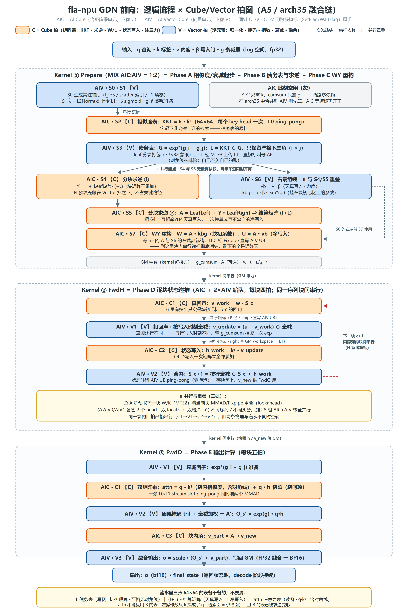
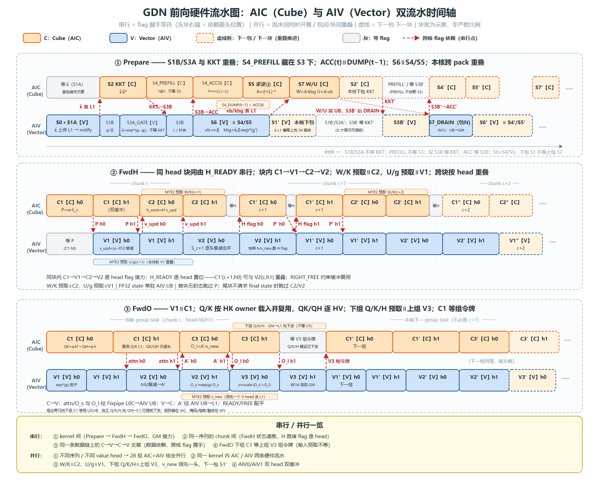

# GDN 原理梳理：算法逻辑流程与硬件流水

---

## 0. 一页读懂

**一次前向 ≈ 982us，由三个 kernel 串行拼成：**

| 段          | 墙钟      | 占比  | 它在算什么                    | 它慢在哪                          |
| ---------- | ------- | --- | ------------------------ | ----------------------------- |
| Prepare    | 447.2us | 45% | 归一化 → 求 64×64 下三角逆 → 算 W/U | 向量段做了一次 64×64 全量逐元素乘（占 26%），vb/kbg 还搬了两遍 |
| FwdH       | 328.7us | 33% | 沿时间递推记忆矩阵 S             | 块间强依赖 + 每块 80KB GM 搬运；同核两个 head 顺序跑 |
| FwdO       | 205.9us | 21% | 用记忆算输出 o                 | Cube→Vector→Cube 两次接力 + 组边界，79% 时间在等 |

**三句话结论：**

1. **算力不是瓶颈。** 三个 kernel 的矩阵乘单次只有 0.04–0.21us，Cube 从来没有跑满过；
   Prepare 的 AIC 甚至空转 61%。
2. **时间花在"接力"和"搬运"上。** Cube 和 Vector 的片上存储互不可见，每次交接都要过 flag、
   过 GM/L1；FwdH 和 FwdO 只有 21–30% 的时间落在计算窗口里，其余都在等接力、等搬运；
   Prepare 虽然 76% 在窗口内，但那 76% 里也有一大半是搬运和逐元素处理。
3. **三个低风险改动可以拿 115–200us（12–20%）**，见下表；升级项另有 70–120us，但要动精度验收。

**优化清单（详见第 6 节）：**

| 顺序 | 动作                                  | 段       | 预计收益          | 风险  |
| -- | ----------------------------------- | ------- | ------------- | --- |
| 1  | Prepare 只算块下三角 + 合并 vb/kbg 搬运         | Prepare | **30–50us**   | 低   |
| 2  | FwdO 的 v_new 预取提前 + 组边界解耦            | FwdO    | **20–40us**   | 低   |
| 3  | FwdH 两个 head 交错（chunk 级轮转）           | FwdH    | **65–110us**  | 中   |
| 4  | Prepare 折叠衰减 + fixpipe 直出（在 1 之上叠加）  | Prepare | +40–60us      | 中   |
| 5  | FwdH 的 right 直写 L1 + v_new 用增广矩阵由 Cube 产出 | FwdH    | +30–60us      | 中   |

**一件明确不要做的事：不要再优化矩阵乘。** 它现在只占 2–3%，把 MMAD 再优化一倍，端到端也看不出变化。

---

## 1. 背景：GDN 在算什么

### 1.1 一句话

GDN（Gated Delta Rule）的每一层，本质是**让每个 token 去更新一个"记忆矩阵" S**，
再用更新后的 S 算出这个 token 的输出。和标准 attention 的区别是：attention 每个 token 都回头
看全部历史（O(T²)）；GDN 把历史压成一个固定大小的 S（O(T)），所以能做长序列。

数学上每一步是：

```
S ← 衰减 ⊙ S + β · k ⊗ (v − kᵀ·S)     ← 状态更新
o  ← qᵀ · S                            ← 读状态
```

其中"衰减"由门控 g 给出（每个 value head 一条），`β` 决定写入强度。
**注意 `kᵀ·S` 这一项**：新 token 在写入之前，要先减掉"它的 key 在旧记忆里已经能解释的部分"，
这就是 delta rule，也是它比普通线性注意力准的原因。

### 1.2 为什么分块（chunk）

上面那个递推是逐 token 的，串行度太高。工程上把序列切成 64 个 token 一块（chunk），
块内用矩阵乘批量算、块间只做一次递推，于是把 O(T) 次串行缩小到 O(T/64) 次，
并且块内可以整块喂给 Cube。代价是要处理三件事：

- 块内 token 之间的相互影响（下三角矩阵）；
- 块起始时要带上"上一块留下的记忆"；
- 每块的衰减因子不同（`exp(g_i − g_j)`）。

这三件事分别对应下面三个 kernel 里最贵的那几步。

### 1.3 三个 kernel 的分工

| kernel      | 产出                  | 干什么                                          | 关键难点                        |
| ----------- | ------------------- | -------------------------------------------- | --------------------------- |
| **Prepare** | A、W、U、g′、β′        | 把 k/v 归一化并按 β 和衰减缩放；构造块内下三角矩阵并求逆；算 W/U       | 求 64×64 下三角逆；两次大矩阵乘          |
| **FwdH**    | h（每块的记忆快照）          | 沿块递推 S：减去历史重复部分 → 算本块写入量 → 更新 S               | 块间必须串行（数学依赖）                |
| **FwdO**    | o（输出）              | 块内用 q·kᵀ 算注意力，块间用 q·h 算历史项，两者相加得输出            | 两次 Cube↔Vector 往返           |

三个 kernel 之间**串行**，中间结果通过 GM 传递。



三个 kernel 内部的步骤：

**Prepare**（AIC:AIV = 1:2）

| 步骤  | 单元 | 计算                                                        |
| --- | -- | --------------------------------------------------------- |
| S0+S1 | V  | 常驻辅助（单位阵/索引/清零）；k̂ = L2Norm(k) 传 L1；g′/β 准备              |
| S2    | C  | KKT = k̂·k̂ᵀ                                                |
| S3    | V  | G = exp\*(g_i−g_j)；L = KKT⊙G 取严格下三角；切出两个 32×32 对角块送 L1    |
| S4    | C  | Y = I + LeafLeft·(−L)（求逆第一步）                              |
| S5    | C  | A = LeafLeft + Y·LeafRight = (I+L)⁻¹                      |
| S6    | V  | vb = v·β，kbg = k̂·β·exp\*(g′)（与 S4/S5 并行）               |
| S7    | C  | W = A·kbg，U = A·vb                                       |

**FwdH**（每块 C1→V1→C2→V2，块间串行）

| 步骤 | 单元 | 计算                                       |
| -- | -- | ---------------------------------------- |
| C1 | C  | P = w·S（上一段记忆对当前块的影响）                    |
| V1 | V  | v_update = (u − P)⊙衰减（先扣掉历史重复信息，再按行衰减）    |
| C2 | C  | h = kᵀ·v_update（本块真正写进记忆的部分）              |
| V2 | V  | S ← 衰减⊙S + h（置 H 就绪，下一块才能开始）             |

**FwdO**（每块五步）

| 步骤 | 单元 | 计算                                             |
| -- | -- | ---------------------------------------------- |
| V1 | V  | 准备衰减因子 exp\*(g)                               |
| C1 | C  | 两个矩阵乘：attn = q·kᵀ（块内）+ O_s = q·h（块间）           |
| V2 | V  | 因果掩码 tril + 衰减 → A′；O_s′ = exp(g)·O_s          |
| C3 | C  | O_l = A′·v_new（块内项）                            |
| V3 | V  | o = scale·(O_s′ + O_l)，FP32 融合后转 BF16 写回         |

---

## 2. 硬件：为什么"接力"贵



**一组核 = 1 个 AIC（Cube）+ 2 个 AIV（Vector）。** 两边的片上存储是分开的：

- AIC 用 **L1**（约 512KB）→ **L0A/B/C**（矩阵乘缓冲），管道是 MTE1（L1→L0）和 Fixpipe（L0C 出结果）；
- AIV 用 **UB**（约 256KB），管道是 MTE2（GM→UB）和 MTE3（UB→GM）。

**两类核的存储互相看不见。** 所以每次 Cube 算完要交给 Vector、或者 Vector 算完要交给 Cube，
都必须经过一次搬运 + 一对 flag（`READY` / `FREE`）。这就是本文反复说的"接力"：

| 接力方式                | 代价                     | 用在哪                       |
| ------------------- | ---------------------- | ------------------------- |
| 走 GM workspace      | 写一次 + 读一次，最贵           | FwdH 的 right / v_new（本次重点） |
| Fixpipe 直写对方 UB/L1 | 只写一次                   | Prepare 的 W/U、FwdO 的 QK   |
| UB↔L1 直写           | 写一次，但仍在关键路径上          | FwdO 的 A′、Prepare 的 k̂     |

**流水的目标不是消灭接力，而是让接力的等待被别的工作填满。** 现在已经用了四层并行：

1. Cube / Vector 两条流水同时跑；
2. 每个缓冲配 `READY/FREE` 做 ping-pong 双缓冲；
3. lookahead 预取（算当前块时搬下一块）；
4. 28 组核按 (序列, value head) 分片，外加 H/O 块级流水。

**但填不满的地方，就是本文要改的地方。**

---

## 3. 实测总账

数据：`B=1, T=11274, Hk=16, Hv=32, chunk=64`（177 个 chunk、5664 个 work item、1416 个 pack），
按 1800 cycles/us 折算。**绝对值等频率标定后要整体缩放，比例关系不受影响。**

| kernel  | 每核墙钟    | 每核最大    | 单次墙钟              | 占全程   |
| ------- | ------- | ------- | ----------------- | ----- |
| Prepare | 447.2us | 459.8us | 8.84us/pack       | 45%   |
| FwdH    | 328.7us | 333.1us | 0.93us/head-chunk | 33%   |
| FwdO    | 205.9us | 208.8us | 1.16us/chunk      | 21%   |

核间很均衡（max/med ≤ 3%），**瓶颈不是分核不均**。

一句话概括三段：**Prepare 是"向量算不完"，FwdH 是"搬运 + 递推依赖"，FwdO 是"传球次数太多"。**

---

## 4. 逐段拆解

> 表里的"单kernel占比" = 该步骤耗时 ÷ 该段墙钟。
> Prepare 的分母是"每 pack 8.84us"，FwdH 是"每 head-chunk 0.93us"，FwdO 是"每核 205.9us"。

### 4.1 Prepare：预处理 + 求逆（447.2us，45%）

**结论：AIV 是唯一关键路径，AIC 有 61% 在空转。**

**AIV lane（打点覆盖 6.75us / 8.84us = 76%）**

| 步骤                          | 打点                | us/pack  | 单kernel占比   | 处理建议       |
| --------------------------- | ----------------- | -------- | ---------- | ---------- |
| **取严格下三角 + 切对角块 + 送 L1**    | `PREP_KKT_EPI`    | **2.32** | **26.2%**  | ★ 只算下三角    |
| 算 kbg = k̂·β·e^g             | `PREP_WU_K`       | 1.10     | 12.4%      | ★ 与 vb 合并搬运 |
| k̂ 归一化并上传 L1               | `PREP_K_UPLOAD`   | 1.06     | 12.0%      | 搬不动（非线性）   |
| 算 vb = v·β                   | `PREP_WU_V`       | 0.96     | 10.9%      | ★ 与 kbg 合并  |
| g′ 累加与 β 预处理                | `PREP_GATE_BETA`  | 0.44     | 5.0%       | 搬不动        |
| W/U 回写 GM                   | `PREP_WU_DRAIN`   | 0.33     | 3.7%       | —          |
| 算衰减权重 G                    | `PREP_KKT_GATE`   | 0.28     | 3.2%       | ★ 可折叠      |
| 等待窗口                        | `WAIT_S4/CUBE`    | 0.26     | 2.9%       | —          |
| **未覆盖（k̂ 的 load+norm 等）**    | —                 | 2.10     | **23.8%**  | 先补窗口量化     |

**AIC lane（打点覆盖 3.44us = 39%）**

| 步骤                    | 打点                   | us/pack | 单kernel占比   |
| --------------------- | -------------------- | ------- | ---------- |
| 求逆第二步 (I+L)⁻¹         | `PREP_SOLVE`         | 0.84    | 9.5%       |
| 算 W = A·kbg           | `PREP_W_ISSUE`       | 0.84    | 9.5%       |
| 求逆中间结果写回              | `PREP_SOLVE_DUMP`    | 0.44    | 5.0%       |
| 求逆第一步 Y              | `PREP_SOLVE_ISSUE`   | 0.36    | 4.1%       |
| 算 KKT                 | `PREP_KKT_MM`        | 0.24    | 2.7%       |
| 单位阵预填充                | `PREP_SOLVE_PREFILL` | 0.16    | 1.8%       |
| 算 U = A·vb             | `PREP_U_ISSUE`       | 0.16    | 1.8%       |
| 等待窗口                  | `WAIT_S1/S3/S6`      | 0.40    | 4.5%       |
| **空闲（等 AIV / 等自己的内存）** | —                    | 5.40    | **61.1%**  |

**为什么慢：** ① AIV 上"取严格下三角"做的是 **64×64 全量逐元素乘**，而下游只取严格下三角，
并且后面还跟着打包、写 L1、两块相乘——一步占了 26%；② vb 和 kbg 是**两次独立**的
"GM→UB→L1"（合计 23.3%）；③ AIC 只有 39% 在干活，但它是被 AIV 喂数据的，所以不能单独提速。

### 4.2 FwdH：逐块状态递推（328.7us，33%）

| 步骤                          | 打点             | us/head-chunk | 单kernel占比   | 谁做的     |
| --------------------------- | -------------- | ------------- | ---------- | ------- |
| 预取下一块的 W/K                 | `FWH_PREFETCH` | 0.09          | 9.7%       | AIC     |
| 算历史重复信息 P = w·S              | `FWH_WH_MM`    | 0.07          | 7.5%       | AIC     |
| 扣历史 + 衰减得 v_update          | `FWH_VNEW`     | 0.04          | 4.3%       | AIV     |
| 算本块写入量 h = kᵀ·v_update      | `FWH_KV_MM`    | 0.06          | 6.5%       | AIC     |
| 状态递推 S ← 衰减⊙S + h           | `FWH_STATE`    | 0.02          | 2.2%       | AIV     |
| **未覆盖（flag 接力 + GM 搬运）**     | —              | 0.65          | **69.9%**  | —       |

打点只覆盖 30.1%，**两个 MMAD 只有 0.06–0.07us，Cube 完全不是瓶颈**。

**为什么慢：**

1. **硬约束是块间递推**：S 没更新完，下一块的 P 就算不了，177 块必须依次走；
2. **每 chunk 有 4 次 C/V 接力**，每次带 flag 延迟和搬运；
3. **同核两个 head 是顺序跑的**，一个在等的时候另一个不干活；
4. **AIV 侧每块要搬 80KB 到 GM**（u 16KB 进、v_new 16KB、right 16KB、H 32KB 出），
   而打点只测了其中的 VF 计算（0.06us）——**AIV 真正的长边在搬运上**。

### 4.3 FwdO：注意力与输出（205.9us，21%）

**AIC lane（每核 202 次调用）**

| 步骤                  | 打点             | med  | 单kernel占比  |
| ------------------- | -------------- | ---- | --------- |
| 块内注意力 attn = q·kᵀ   | `FWO_QK`       | 0.04 | 3.9%      |
| 块间项 O_s = q·h      | `FWO_QH`       | 0.04 | 3.9%      |
| 块内项 O_l = A′·v_new | `FWO_ATTN_V`   | 0.04 | 3.9%      |
| **未覆盖（接力 + 组边界）**    | —              | —    | **88.3%** |

**AIV lane（每核 101 次调用）**

| 步骤                  | 打点             | med  | 单kernel占比  |
| ------------------- | -------------- | ---- | --------- |
| 衰减因子 exp\*(g)       | `FWO_GATE`     | 0.05 | 2.5%      |
| 因果掩码 + 衰减 → A′      | `FWO_MASK`     | 0.08 | 3.9%      |
| 融合输出 o             | `FWO_OUTPUT`   | 0.05 | 2.5%      |
| **未覆盖（接力 + 组边界）**    | —              | —    | **91.1%** |

合计打点 20.6%，**79.4% 在窗口外**。

**为什么慢：** FwdO 每算一个 head 要走 `Cube(QK/QH) → Vector(mask) → Cube(ATTN_V) → Vector(output)`，
**两次往返、四个 flag**。组边界还要等上一组所有 head 的输出收尾才能复用缓冲。
AIV 侧每个 head 有 6 个 UB 读写点，但那 120KB 里只有 16KB 落 GM——它的时间不是"搬得多"，
是"传球次数多"。

> 补充：`FWO_GATE` 在图上"一次两段"是正常的。`taskGroupSize = 4`，AIV0 负责 head 0/2、
> AIV1 负责 1/3，所以每个 chunk 每个 AIV 调 2 次，两段是两个不同的 head。

---

## 5. 为什么现在慢（四条）

**① 算力不是瓶颈。** 三个 kernel 的矩阵乘单次 0.04–0.21us，
Prepare 的 Cube 段只占 3–9%，FwdH/FwdO 的 MMAD 合计不到 0.2us/call。

**② 时间是"接力"和"搬运"。** 除 Prepare 的 AIV（76%）外，其余 lane 的计算窗口只有
6–39%；FwdH 每块 80KB GM 流水，FwdO 每 head 两次 C/V 往返——这些都不在计算窗口里。

**③ 资源没配平。** Prepare 的 AIC 空转 61%，因为它要等 AIV 喂 KKT；
真正的关键路径只有 AIV 一条。

**④ 三段还是串行的。** Prepare → FwdH → FwdO 没有重叠，端到端就是 447 + 329 + 206，
外加约 4us 的下发间隔。

> 顺带纠正两个容易误判的现象：
> - **"后半段只有 AIV 没有 AIC"**：采样上限（每核每项 64 次）造成的，AIC 每核迭代数是 AIV 的 2 倍，
>   所以它的样本先用完；AIC 并没有停工。
> - **"首块特别慢"**：`iter0` 要付指令取指和首次 GM 读的冷启动（`FWO_GATE` 首块 0.53us vs 稳态 0.097us），
>   不要拿 `max` 当稳态。

---

## 6. 优化点

### 6.1 总表

| 顺序 | 动作                                          | 段       | 收益                  | 风险  | 依赖                    |
| -- | ------------------------------------------- | ------- | ------------------- | --- | --------------------- |
| 1  | **只算块下三角 + 合并 vb/kbg 搬运**                   | Prepare | **30–50us**         | 低   | 无                     |
| 2  | **v_new 预取再提前一个 head + 组边界解耦**              | FwdO    | **20–40us**         | 低–中 | 需确认缓冲复用正确性            |
| 3  | **两个 head 交错（chunk 级轮转）**                   | FwdH    | **65–110us**        | 中   | 只改调度不改数学              |
| 4  | **衰减折叠 + fixpipe 直出**（第 1 条的升级版）              | Prepare | +40–60us            | 中   | 依赖 1；要过精度门禁           |
| 5  | **right 直写 L1 + v_new 用增广矩阵由 Cube 产出**       | FwdH    | +30–60us            | 中   | 需 L1 槽位；与 3 部分重叠       |
| 6  | 给 k̂ 的 load+norm 补一个计算窗口                    | Prepare | 待量化（~2us/pack）      | 低   | 只是为了看清，不直接提性能         |
| 7  | 三段融合成 PHASE6                               | 全局      | ~4us                | 高   | 需过数值验收，且影响发布形态        |

**先做 1+2+3：预计 115–200us（12–20%）。** 4、5 是升级项，与 1、3 有重叠，
做完前三条再重新评估，不要简单相加。

### 6.2 逐条展开

#### ① Prepare 只算块下三角 + 合并 vb/kbg 搬运（30–50us）

- **现象**：`PREP_KKT_EPI` 2.32us/pack（26.2%），做的是 64×64 全量逐元素乘，
  但下游只用严格下三角；vb 和 kbg 各自走一遍 GM→UB→L1（合计 23.3%）。
- **依据**：上三角部分乘完就被丢掉；vb/kbg 是两次同构的行缩放，可以并成一次
  （k̂ 只读一次、UB 只写一次，L1 分两个槽位）。
- **动作**：向量乘只在严格下三角内做（行宽随 i 递减，或先 mask 再乘）；
  vb/kbg 合并成一次 UB 处理 + 两次 L1 写。
- **预期**：0.4–0.5us/pack + 0.3–0.4us/pack → 30–50us。
- **风险**：低。只跳过"反正不用"的计算，数值完全不变；注意尾块和向量对齐。

#### ② FwdO 预取提前 + 组边界解耦（20–40us）

- **现象**：79.4% 时间在窗口外；组边界是串行点（下一组的 C1 要等本组所有 head 的 V3）。
- **依据**：v_new 的预取已经领先一个 head，但还不够——组尾的 V3 收尾时，
  下一组的 QK 其实已经可以开始，只是被缓冲复用挡住。
- **动作**：v_new 预取再提前一个 head；组边界只保留"缓冲复用必需"的那一次等待。
- **预期**：20–40us。
- **风险**：低–中。主要是正确性：提前复用缓冲会踩数据，需要把 READY/FREE 配平。

#### ③ FwdH 两个 head 交错（65–110us）

- **现象**：329us 里只有 30% 在算，70% 在等；同核的 2 个 head 是"跑完一个再跑下一个"。
- **依据**：两个 head 之间没有数据依赖（各有一条 S），一个 head 的等待完全可以用另一个的计算填满。
- **动作**：把 work unit 的粒度从"head"改成"chunk"，两个 head 按 chunk 轮转。
- **预期**：20–35% → 65–110us。
- **风险**：中。不动数学，但要保证 S 的 UB 驻留和 L0 bank 不冲突；
  如果先做了第 5 条（砍字节），这一条的收益会变小——**建议先做 1、2，再看 3 和 5 的先后**。

#### ④ Prepare 衰减折叠 + fixpipe 直出（+40–60us）

- **现象**：`exp(g_i − g_j)` 现在真的算了一个 64×64 的指数矩阵（4096 次 exp），
  再和 KKT 逐元素乘；之后还要 L0C→UB→打包→L1，一共 6 次 UB 往返。
- **依据**：`exp(g_i − g_j) = e^{g_i} · e^{−g_j}` 是秩 1 的，
  把 k̂ 按行预缩放成 `k̃ = k̂·β·e^g` 之后，**`k̃·k̂ᵀ` 直接就是 L**，不需要指数矩阵；
  非对角块可以由 Cube 从 L0C 直接写 L1。
- **动作**：k̃ 提前到 S1 算（它本来就是 kbg，可以复用）；只发块下三角的 MMAD；
  对角 4 个 16×16 块保留向量掩码；负号对小 leaf 取反，避免为 `−L` 再多一趟。
- **预期**：+40–60us（叠加在第 1 条上）。
- **风险**：中。缩放后的 bf16 会多一次舍入，重衰减场景要按块减基准防溢出；
  **必须重跑精度门禁**。

#### ⑤ FwdH 的 right 直写 L1 + v_new 增广矩阵（+30–60us）

- **现象**：AIV 每块往 GM 写 80KB（u 进、v_new/right/H 出），其中 `right` 是纯内部中转
  （AIV 写 GM、AIC 立刻读回 L1）。
- **依据**：FwdO 的 A′ 已经直接写 L1（`DataCopy(l1APrime, ...)`），FwdH 照做即可；
  `v_new = u − W·S` 可以写成 `[W | u] @ [S; −I]`，让 Cube 直接产出，AIV 不再读 u、写 v_new。
- **动作**：给 right 分一个 L1 槽位 + READY/FREE；v_new 改成增广矩阵。
- **预期**：AIV 侧 80KB → 48KB，每块省 ~0.18us → 30–60us。
- **风险**：中。L1 槽位紧张；增广矩阵会多占 L0B；精度要验。

#### ⑥ 给 k̂ 的 load+norm 补窗口（仅为量化）

`PREP_K_UPLOAD` 之前的 `DataCopy(ubK)` + `L2NormK128VF` 没有打点，
按覆盖率推算约 2.1us/pack（23.8%）。**先补窗口看清楚，再决定要不要融进 K_UPLOAD**。

#### ⑦ 三段融合（~4us，暂缓）

融合 launch 能省掉段间空泡和一次 init，但收益只有 ~4us，且影响发布形态和数值验收，
优先级最低。

### 6.3 明确不做的

- **不优化矩阵乘**：占 2–3%，优化一倍也看不出；
- **不加全核 SyncAll**：会破坏 C/V 重叠，而且 Prepare 的 tiling 没开 batch mode，会挂；
- **不按 `max` 定目标**：首块/尾块是冷启动；
- **不只看 `KERNEL_TIMING`**：它含 init 和末尾 drain，正式口径以 msprof Task Duration 为准。

### 6.4 需要拍板的三件事

1. **做一次频率标定**（约 10 分钟）：用 msprof 的 Task Duration 对齐 `KERNEL_TIMING`。
   现在所有 us 都是按 1800 cycles/us 估的，比例可信、绝对值要标定后才能定性能目标。
2. **定性能目标**：从 982us 降到多少？如果是 15%，前三条就够；如果要 30% 以上，必须做 4、5。
3. **是否允许改发布形态**：第 7 条（融合）会动 launch 结构，需要提前定。

---

## 7. 数据可信度（口径与限制）

1. **issue ≠ 执行**：AIC 的 bar 会比 AIV 早 3–4us（标量跑在 `PIPE_MTE1` 前面），
   图上"KKT 在 K_UPLOAD 之前"是正常现象，执行顺序由 pipe 保证；
2. **每核每项只存 64 次**：AIC 每核迭代数是 AIV 的 2 倍，所以 64 个槽位只盖住
   AIC 的前 ~32%、AIV 的前 ~63%；中位数只代表前 1/3 的 chunk，并且混进了首块冷启动；
3. **本次数据里没有 MTE2/MTE3 打点**：只能看到 VF 计算和 MMAD 下发，
   AIV 侧的取数与写回都在"未覆盖"里；本文的字节数来自代码里的 `DataCopy` 尺寸，不是实测。
   已在 `feat/gdn-kernel-timer`（commit `e8852ef8`）补上 `MTE2` / `MTE3` 两个等待窗口，
   **重编算子后**才能在曲线上看到；
4. **频率未标定**：1800 cycles/us 是估计值；本文所有 us 只用于横向比较；
5. **不是稳态**：数据来自一次调用，含首块冷启动和尾块；定目标时看 `med` 不看 `max`。

---

## 附录 A：AIV 侧字节明细（改搬运时用）

### A.1 Prepare（1 个 task = 1 chunk × 1 hv）

| 步骤                | AIV 侧关键搬运                          | GM/L1 字节  | UB 往返 | 占 pack |
| ----------------- | --------------------------------- | --------- | ----- | ----- |
| k̂ 归一化上传          | k 16KB 进；k̂ 16KB 出 GM（仅独立模式）、16KB 进 L1 | 32–48KB   | 2     | 12.0% |
| g′ 与 β            | 各 0.5KB 进出                        | 1KB       | 1     | 5.0%  |
| 衰减矩阵 G            | 写 64×64 fp32（16KB）               | 0         | 1     | 3.2%  |
| 取严格下三角 + 打包 + 送 L1 | L 16KB 读、打包 16KB、VCS 32KB、L1 16KB 写 | 16KB（L1）  | **6** | 26.2% |
| 算 kbg             | k̂ 16KB 读、16KB 写 L1               | 16KB（L1）  | 2     | 12.4% |
| 算 vb              | v 16KB 读、16KB 写 L1                | 16KB（L1）  | 2     | 10.9% |
| W/U 回写            | 32KB → GM                         | 32KB      | 2     | 3.7%  |

### A.2 FwdH（1 个 head-chunk，K = V = 128，bf16）

| AIV 侧动作                     | 字节      | 去向                  |
| -------------------------- | ------- | ------------------- |
| 读 u                        | 16KB    | GM（L2 cache 关闭）     |
| 写 v_new                    | 16KB    | GM                  |
| 写 right                    | 16KB    | GM（内部中转，AIC 立刻读回）   |
| 状态递推 S                     | 32–64KB | UB 内原地             |
| 写 H                        | 32KB    | GM                  |

GM 合计 **80KB**；VF 只有 0.06us。

### A.3 FwdO（1 个 head，bt = 64，V = 128）

| AIV 侧动作              | 字节      | 去向              |
| ------------------- | ------- | --------------- |
| 读 g                 | 0.25KB  | GM              |
| 写 gateA（4096 次 exp） | 16KB    | UB              |
| 读 aRaw             | 16KB    | Cube fixpipe→UB |
| 写 aPrime           | 8KB     | UB→L1           |
| 读 oSPrime          | 32KB    | Cube→UB         |
| 读 O_l              | 32KB    | Cube→UB         |
| 写 o                | 16KB    | UB→GM           |

合计约 120KB/head，其中只有 16KB 落 GM。

---

## 附录 B：Prepare 的 64×64 求逆怎么拆成两次矩阵乘

`I+L` 是 64×64 的下三角矩阵，按 32 分块：

```
[ I+A   0  ]
[  C   I+D ]
```

它的逆可以用块公式写出来，只需要先求两个对角块的逆：

```
[ (I+A)⁻¹                    0        ]
[ −(I+D)⁻¹·C·(I+A)⁻¹        (I+D)⁻¹   ]
```

所以 kernel 不对 64×64 直接求逆，而是：

1. **切块**：从 64×64 的 L 里取左上 32×32（A）和右下 32×32（D），拼成 `[A | D]`；
2. **对角块求逆**：在 Vector 上同时算 `(I+A)⁻¹` 和 `(I+D)⁻¹`，按 scatter 索引写回；
3. **送 L1**：两块逆放回 64×64 叶子矩阵的对角象限；
4. **拼回 64×64**：`Y = I + LeafLeft·(−L)`，`A = LeafLeft + Y·LeafRight`，两次矩阵乘搞定。

开销集中在前三步（逐元素乘、两次 DataCopy、16KB L1 写、对角块求逆），
也就是第 4.1 节里 26% 的那一步。

---

## 附录 C：打点名对照（按流程顺序）

> 每个 kernel 从上往下就是它的执行顺序；"单元"是打点所在的核。
> 固定项（`KERNEL_TIMING_IDX` / `MAIN_INIT` / `MAIN_BODY` / `ANCHOR`）三个 kernel 各有一份，见 C.4。

### C.1 Prepare：S0 → S7

| #  | 阶段        | 打点                     | 单元      | 量的是什么                          |
| -- | --------- | ---------------------- | ------- | ------------------------------ |
| 1  | Init      | `PREP_INIT_MAP`        | AIV/AIC | 建地址视图（每核一次）                    |
| 2  | Init      | `PREP_INIT_WS`         | AIV/AIC | 绑 workspace                     |
| 3  | Init      | `PREP_INIT_GM`         | AIV/AIC | GM SetGlobalBuffer 批次          |
| 4  | S0        | `PREP_RESIDENT_AUX`    | AIV     | 常驻辅助：清零 4 个 leaf 槽 + AIV0 画单位阵  |
| 5  | S1-pre    | `PREP_PAD_TAIL`        | AIV     | 尾块补零（仅 M<64 时执行）               |
| 6  | S1a       | `PREP_K_UPLOAD`        | AIV     | k̂ 归一化 + 上传 L1                  |
| 7  | S1b       | `PREP_GATE_BETA`       | AIV     | g′ 累加 + β sigmoid              |
| 8  | S1 尾      | `PREP_NOTIFY_S1`       | AIV     | 通知 Cube 可以算 KKT（跨核时间校准锚点）      |
| 9  | S2        | `PREP_KKT_MM`          | AIC     | KKT = k̂·k̂ᵀ 的 MMAD 下发           |
| 10 | S3a       | `PREP_KKT_GATE`        | AIV     | G = exp\*(g_i−g_j) + I_vcs 拷贝   |
| 11 | S3b       | `PREP_KKT_EPI`         | AIV     | L = KKT⊙G 取严格下三角 + 打包 + 送 L1    |
| 12 | S4-pre    | `PREP_SOLVE_PREFILL`   | AIC     | I·I 预填充                        |
| 13 | S4-issue  | `PREP_SOLVE_ISSUE`     | AIC     | Y = I + LeafLeft·(−L)           |
| 14 | S4/S5-dump | `PREP_SOLVE_DUMP`     | AIC     | L0C → L1/UB                     |
| 15 | S5        | `PREP_SOLVE`           | AIC     | A = (I+L)⁻¹                     |
| 16 | S6a       | `PREP_WU_V`            | AIV     | vb = v·β（GM→UB→L1）              |
| 17 | S6b       | `PREP_WU_K`            | AIV     | kbg = k̂·β·e^g（GM→UB→L1）        |
| 18 | S7a       | `PREP_W_ISSUE`         | AIC     | W = A·kbg 下发                    |
| 19 | S7b       | `PREP_U_ISSUE`         | AIC     | U = A·vb 下发                     |
| 20 | 下一包       | `PREP_WU_DRAIN`        | AIV     | W/U 回写 GM                       |

> 并行关系：S6（AIV）与 S4/S5（AIC）同时跑，S7 等 S6 与 S5 都完成。
>
> 等待项（只包已有同步，用来对齐生产/消费）：AIC 侧 `PREP_WAIT_S1`、`PREP_WAIT_S3`、`PREP_WAIT_S6`；
> AIV 侧 `PREP_WAIT_S4`、`PREP_WAIT_CUBE`。

### C.2 FwdH：C0 → C1 → V1 → C2 → V2

| # | 阶段  | 打点             | 单元  | 量的是什么                          |
| - | --- | -------------- | --- | ------------------------------ |
| 1 | C0  | `FWH_PREFETCH` | AIC | 下一块 W / kg 的 GM→L1（lookahead）  |
| 2 | C1  | `FWH_WH_MM`    | AIC | P = w·S 的 MMAD 下发               |
| 3 | V1  | `FWH_VNEW`     | AIV | v_new = (u−P)⊙衰减 的向量窗口          |
| 4 | C2  | `FWH_KV_MM`    | AIC | h = kᵀ·v_new 的 MMAD 下发          |
| 5 | V2  | `FWH_STATE`    | AIV | S ← 衰减⊙S + h（置 H 就绪）           |

> 这五步每 chunk 一轮，块间串行；C0 是给下一块准备的，和本轮 C1 重叠。

### C.3 FwdO：V1 → C1a → C1b → V2 → C3 → V3

| # | 阶段  | 打点             | 单元  | 量的是什么                          |
| - | --- | -------------- | --- | ------------------------------ |
| 1 | V1  | `FWO_GATE`     | AIV | 衰减因子 exp\*(g)                   |
| 2 | C1a | `FWO_QK`       | AIC | attn = q·kᵀ 的 MMAD 下发           |
| 3 | C1b | `FWO_QH`       | AIC | O_s = q·h 的 MMAD 下发             |
| 4 | V2  | `FWO_MASK`     | AIV | tril + 衰减 → A′；O_s′             |
| 5 | C3  | `FWO_ATTN_V`   | AIC | O_l = A′·v_new 的 MMAD 下发        |
| 6 | V3  | `FWO_OUTPUT`   | AIV | o = scale·(O_s′ + O_l)          |

> V1 与 C1a/C1b 是并行的（C1 不等 gate）；V2 → C3 → V3 是逐 head 接力。

### C.4 公共项：固定项 + 搬运等待

| 固定项                | 量的是什么                        |
| ------------------ | ---------------------------- |
| `KERNEL_TIMING_IDX` | kernel 整体墙钟（带 barrier 收尾）     |
| `MAIN_INIT`        | Init → InitDone              |
| `MAIN_BODY`        | InitDone → kernel 结束         |
| `ANCHOR`           | 每核 body 起点，用来做跨核时间校准          |

| 搬运等待（`e8852ef8` 新增） | 单元  | 量的是什么             | 挂在哪                                                    |
| ------------------ | --- | ----------------- | ------------------------------------------------------ |
| `MTE2`             | AIV | 等输入从 GM 到达        | Prepare：k/q 载入；FwdH：u 到达；FwdO：g 到达                     |
| `MTE3`             | AIV | 等上一轮写回完成 / 槽位可复用 | Prepare：MTE3_MTE2 水位；FwdH：IoFreeEvent；FwdO：mte3ToVStream |

---

## 附录 D：术语表

| 词        | 意思                                                   |
| -------- | ---------------------------------------------------- |
| AIC / C  | Cube 核，做矩阵乘；一组核里 1 个                                   |
| AIV / V  | Vector 核，做逐元素/归约；一组核里 2 个                             |
| L1 / UB  | 两类核各自的片上缓冲；互相看不见                                     |
| 接力       | Cube 与 Vector 之间交换中间结果（flag + 搬运），本文的"贵"就在这           |
| chunk    | 64 个 token 一块，块内并行、块间递推                                |
| pack     | Prepare 的调度单位，一个 pack 里最多 4 个 task                   |
| 打点       | kernel 里读写 cycle 计数器的计时代码，用来还原每步耗时                     |
| 未覆盖      | 墙钟里没有被任何打点窗口盖住的部分，主要是等待和搬运                           |
| 计算窗口     | 打点覆盖到的"在算"的时间，区别于整条 lane 的占用                          |
| delta rule | 写入前先减掉"旧记忆已经能解释的部分"，GDN 精度来源                          |

---

## 附录 E：全部步骤占比一览

> 分母：Prepare 为"每 pack 8.84us"，FwdH 为"每 head-chunk 0.93us"，FwdO 为"每核 205.9us"。
> ★ = 建议优化，✗ = 明确不优化。

| 阶段      | lane | 步骤                          | 单kernel占比  | 判定          |
| ------- | ---- | --------------------------- | --------- | ----------- |
| Prepare | AIV  | 取严格下三角 + 切对角块 + 送 L1         | **26.2%** | ★ 只算下三角     |
| Prepare | AIV  | 算 kbg = k̂·β·e^g             | 12.4%     | ★ 与 vb 合并   |
| Prepare | AIV  | k̂ 归一化并上传 L1                | 12.0%     |             |
| Prepare | AIV  | 算 vb = v·β                   | 10.9%     | ★ 与 kbg 合并  |
| Prepare | AIV  | g′ 累加与 β 预处理                | 5.0%      |             |
| Prepare | AIV  | W/U 回写 GM                   | 3.7%      |             |
| Prepare | AIV  | 算衰减权重 G                    | 3.2%      | ★ 可折叠       |
| Prepare | AIV  | 等待窗口                        | 2.9%      |             |
| Prepare | AIV  | **未覆盖（k̂ 的 load+norm 等）**    | **23.8%** | ★ 先补窗口量化    |
| Prepare | AIC  | 求逆第二步 (I+L)⁻¹               | 9.5%      |             |
| Prepare | AIC  | 算 W = A·kbg                 | 9.5%      |             |
| Prepare | AIC  | 求逆中间结果写回                    | 5.0%      |             |
| Prepare | AIC  | 求逆第一步 Y                    | 4.1%      |             |
| Prepare | AIC  | 算 KKT                       | 2.7%      | ✗ 算力不是瓶颈    |
| Prepare | AIC  | 单位阵预填充                      | 1.8%      |             |
| Prepare | AIC  | 算 U = A·vb                   | 1.8%      |             |
| Prepare | AIC  | 等待窗口                        | 4.5%      |             |
| Prepare | AIC  | **空闲（等 AIV / 等内存）**         | **61.1%** | ✗ AIV 才是关键路径 |
| FwdH    | AIC  | 预取下一块的 W/K                  | 9.7%      | ★ 加深 lookahead |
| FwdH    | AIC  | 算历史重复信息 P = w·S              | 7.5%      |             |
| FwdH    | AIC  | 算本块写入量 h                    | 6.5%      | ✗ MMAD 太快   |
| FwdH    | AIV  | 扣历史 + 衰减得 v_update          | 4.3%      |             |
| FwdH    | AIV  | 状态递推 S                      | 2.2%      |             |
| FwdH    | 两条   | **未覆盖（flag 接力 + 搬运）**       | **69.9%** | ★★ 两 head 交错 |
| FwdO    | AIC  | 块内注意力 attn = q·kᵀ           | 3.9%      | ✗           |
| FwdO    | AIC  | 块间项 O_s = q·h              | 3.9%      | ✗           |
| FwdO    | AIC  | 块内项 O_l = A′·v_new         | 3.9%      | ✗           |
| FwdO    | AIC  | **未覆盖（接力 + 组边界）**           | **88.3%** | ★ 预取/组边界    |
| FwdO    | AIV  | 衰减因子 exp*(g)               | 2.5%      | ★ 与掩码融合     |
| FwdO    | AIV  | 因果掩码 + 衰减 → A′             | 3.9%      | ★ 与衰减融合     |
| FwdO    | AIV  | 融合输出 o                     | 2.5%      |             |
| FwdO    | AIV  | **未覆盖（接力 + 组边界）**           | **91.1%** | ★★ 预取/组边界   |

